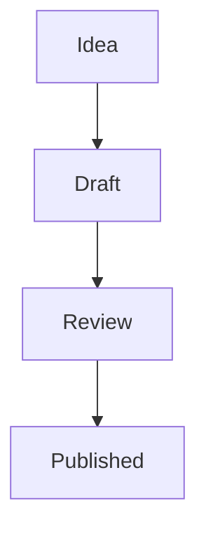

# Editor

Editor is a two-pane text editor for the files in your BrowserOS home: the left
pane is the editor, the right pane is a chat with a BrowserOS agent, and both
write to the **same document**. When the agent rewrites a paragraph you see it
appear under your cursor — there is no second copy to merge, and nothing is
written to disk until you save.

It knows three kinds of file:

| Kind | Extensions | Preview shows |
| --- | --- | --- |
| Markdown | `.md`, `.markdown`, `.mdx`, `.mdown` | the formatted document |
| HTML | `.html`, `.htm` | the **rendered page** |
| Plain text | `.txt`, `.log`, `.env`, anything else | the text as-is |

The kind is picked from the filename, so it follows a Save As: rename
`notes.txt` to `notes.md` and the preview starts formatting it. It is worked out
fresh every time Editor starts, too — a tab restored from a previous session is
opened with the kinds this version of Editor knows about, not the ones it knew
when you last closed it.

## The basics

- **Open** — the toolbar's *Open* button browses your files. Each document gets
  its own tab; the dot on a tab means unsaved changes.
- **Edit / Preview** — the toggle in the middle of the toolbar. Edit is a
  monospace editor with line numbers; Preview renders the document.
- **Save** — the *Save* button or `Ctrl`/`Cmd` + `S`. A brand-new document asks
  where to put it first.
- **Closing a tab** with unsaved changes always asks before discarding — including
  changes the agent made rather than you.
- **Settings** (the gear) has two tabs: **Appearance** sets the font, the size,
  and the colours used for headings, links and code blocks in both panes;
  **Custom Styles** manages the named styles used by fenced divs in Markdown
  previews (see below).

Documents survive a restart: your open tabs, the split position and your
appearance settings are all remembered, unsaved buffers included.

## Opening files from the Files app

Editor registers itself as a file handler for **Markdown** (`.md`), **plain
text** (`.txt`) and **HTML** (`.html`/`.htm`), so the Files app knows about it:

- **Double-click a `.md` file** and it opens straight in Editor, in **Preview**
  mode — the formatted document, tables and custom styles included. Flip to
  *Edit* for the source.
- **Double-click a `.txt` file** and it opens in Editor too, in **Edit** mode
  (plain text has no richer preview than itself, so Editor doesn't pretend
  otherwise).
- **Right-click** any `.md`, `.txt`, `.html` or `.htm` file and pick **Open
  with Editor** from the *Open with* section. For HTML you will also see
  **Open with Web View** (the built-in read-only previewer) there; an HTML file
  picked this way opens in **Preview** mode.

Things worth knowing about that menu:

- The **checkmark** marks the app a file type opens with when you just
  **double-click**. Markdown and plain text point at Editor from the moment it
  is installed; HTML stays with Web View until you choose otherwise. Picking a
  different app in the menu moves the checkmark, and double-click follows it
  from then on.
- If the file is **already open in a tab**, Editor focuses that tab instead of
  opening the same file twice — so you never end up with two tabs quietly
  disagreeing about the same file.

Editor asks BrowserOS for the file's contents itself, which means the usual
rules apply: it can only read files you can read, and it writes nothing until
you save.

## Custom styles: named callout boxes in Markdown

Markdown previews understand pandoc's *fenced div* syntax — a way to wrap a
block of a document in a named, styled container:

```markdown
::: {custom-style="Note"}
Action items were assigned to each team lead — see the tracker.
:::
```

In **Preview**, that block renders as a styled callout box. The shorter class
form does the same thing: `::: {.Note}`. In **Edit** mode you always see the
raw `:::` source, unmodified — the syntax is plain markdown text.

Where the appearance comes from:

- **Built-in styles** — Editor ships four: `Note`, `Info`, `Warning` and
  `Tip`. Their names are fixed, but you can override their CSS (and reset it
  back) in Settings.
- **Your styles** — open **Settings (the gear) → Custom Styles → Add style**,
  give it a name (say `PinkBox`) and a CSS declaration block, and any document
  using `::: {custom-style="PinkBox"}` renders with it. The live preview in the
  editor updates as you type, your styles persist across restarts, and you can
  rename, edit or remove them freely.
- **Or just ask the agent.** "Make me a style for terminal output", "the Note
  boxes are too purple, tone them down", "drop the PinkBox style" — the agent
  has the same five operations the Settings panel does, and the change shows up
  in Settings and in every open preview straight away. Built-in styles behave
  the same way for it as for you: their CSS can be changed and reset, their
  names cannot.
- **Unknown names never lose content.** A fenced div whose name isn't in the
  registry — a typo, or a document authored elsewhere — still renders, in a
  neutral container. Nothing is dropped and nothing breaks.

A few more behaviours:

- Saving a style — in Settings or through the agent — restyles any open preview
  **immediately**. Styles are a setting, not document content: there is nothing
  to save afterwards, and the change applies to every document you open.
- Fenced divs **nest**: a `Note` can contain a `Warning`, and each keeps its
  own style.
- A `:::` inside a fenced ``` code block is literal code, never a container
  boundary — so documents *about* the syntax render correctly.
- Tables render properly too: GitHub-style pipe tables get real headers, body
  rows and per-column alignment (`:---`, `:---:`, `---:`) in the preview,
  including inline markdown inside cells and escaped pipes (`\|`).

## Diagrams

A code block tagged `mermaid` renders as a diagram in Preview:

````markdown

````

Anything [Mermaid](https://mermaid.js.org) understands works — flowcharts,
sequence diagrams, state diagrams, class diagrams, Gantt charts, pie charts. In
**Edit** mode you keep the plain text you typed; the diagram is drawn only in
Preview, and it redraws as you type.

- **A diagram with a syntax error doesn't disappear.** You get Mermaid's
  complaint and your source underneath it, so you can see what to fix.
- **Code blocks in other languages are untouched** — only a block tagged
  `mermaid` is drawn.
- The agent can write these too: "add a flowchart of the release process" leaves
  a `mermaid` block in the document, and the preview draws it.

## How the HTML preview works

For an HTML file, *Preview* is not a formatted approximation — it is the page,
rendered:

- **It shows your unsaved buffer, not the file on disk.** Type in *Edit*, switch
  to *Preview*, and you are looking at what you just typed. Ask the agent to
  restyle the page and the preview follows on its next redraw. Nothing needs to
  be saved first.
- **Scripts in the page run.** A preview that silently skipped the page's own
  JavaScript would be misleading about what the file actually does.
- **The page is sandboxed.** It renders in an isolated frame with no access to
  Editor, to BrowserOS, or to your files — so previewing a page you did not
  write cannot read your documents or act as you.

Because the page brings its own styling, the Editor appearance settings do not
apply to an HTML preview; they still apply to the Markdown preview and to the
editor itself.

A few practical notes:

- Relative links and `` will not resolve — the preview is
  rendered from the buffer, not from the file's folder, so it has no notion of
  "next to this file". Absolute `https://…` URLs work normally.
- A fragment is fine: you do not need `<html>` and `<body>` for the preview to
  render something sensible.
- Links that navigate will do so **inside** the preview frame. Switch modes, or
  reopen the file, to get back.

*Edit* mode is the raw source — the same monospace editor with line numbers you
get for any other file. Editor never reformats or "tidies" your HTML; what you
save is what you typed.

## Working with the agent

The chat on the right talks to a BrowserOS agent that can read and change the
document you have open — "tighten the intro", "add a summary table", "convert
this list into a `<table>`". Its edits land in the buffer, so they are
previewable immediately and yours to save or discard. Tool calls the agent made
are shown as chips under its reply, and an edit that came from the agent is
flashed in the status bar so it is never mistaken for something you typed.

It can also manage the custom styles above — listing them, adding one, changing
or renaming one, deleting a style of yours, and resetting a built-in to how it
shipped. Those are settings rather than text, so they take effect at once and
there is nothing to save.

**If the chat answers "Capability assistant not granted"**, the Editor has not
been allowed to drive the agent yet: open **Settings → Apps**, find *Agentic
Text Editor* and turn on **Assistant**. A fresh install asks for it up front; an
Editor installed before this existed needs it switched on once.

Conversations are picked in the chat header, along with which agent you are
talking to; the transcript belongs to the conversation, not to a tab, so
switching tabs never changes what you are reading.
