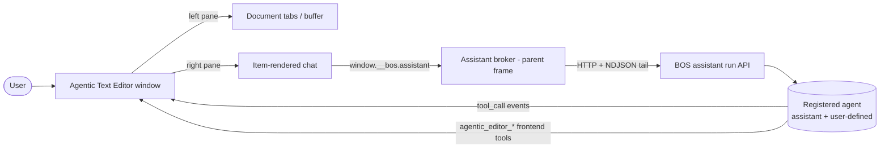

# Architecture Design: Agentic Text Editor — v2 (Agent & Conversation Management + Full Tool-Call Visibility)

**Spec**: `item-agentic-text-editor/spec.md` · **Target**: marketplace item, `app/` facet only · **Mockup**: `item-agentic-text-editor/ui-mockup.html` (UI contract)

This is an **incremental v2** on an already-installed item. v1 (document tabs + embedded chat + `agentic_editor_*` frontend tools) is the baseline; this design covers only the three v2 changes (FR-023 / FR-024 / FR-025) and the app-side plumbing they require.

---

## 1. Classification

**App Target: `marketplace-item` — `app/` facet only (no `services/` facet, no BOS source change).**

- The item lives at `data/user-apps/items/agentic-text-editor/` and is installed as a sandboxed-iframe app (`docs/dev/apps/installed-apps.md`). It is not `src/apps/<id>/` (not `builtin-app`) and does not modify any file under `src/` (not `bos-core`).
- No background daemon, network port, or raw-protocol need → **no `services/` facet** (the Terminal-style worker-thread mechanism is not in scope).
- **Agrees with the spec** — `spec.md` declares `**App Type**: Marketplace (data/user-apps/items/agentic-text-editor/)` and the task brief. No reconciliation needed.

### The one premise this design corrects

The delegation brief says the app "registers its `agentic_editor_*` tools via `registerAppSurfaceTools` (`src/lib/assistant/client/surface-tools.ts`)." That is the **main-bundle** API and a marketplace item **cannot use it**:

- A marketplace `app/` facet is bundled by esbuild into a **single IIFE** (`src/lib/apps/build.ts` → `format: "iife"`, `nodePaths` points at BOS `node_modules`, and there is **no `@/` alias**), running inside a **sandboxed iframe = a separate JS context**. It cannot `import` or share the main frame's module-level `registerAppSurfaceTools` Map, nor mount the main-bundle `AssistantChatV2` component.
- The item's **only** channel into the assistant is the **assistant broker**: `window.__bos.assistant.*` (`src/lib/iframe-sdk/index.ts`), whose parent side is `src/components/apps/assistant-broker.ts` (feature 040). Frontend/surface tools for a marketplace app ride the **`startRun` body's `surfaceTools`** parameter (`assistant-broker.ts` `startRun()` → `POST /api/assistant/runs`), which `startAssistantRun` merges into `run.tools` (`src/lib/assistant/start-run.ts`). This is the real mechanism v1 already relies on to make `agentic_editor_*` callable; v2 keeps it unchanged.

This correction is load-bearing for the whole design (the item talks to the assistant purely through the broker + VFS, not through main-bundle modules) and is documented in **ADR-1**.

---

## 2. Constitution check

| Principle | Compliance |
|---|---|
| **I. Spec-Driven** | v2 is fully specified (FR-023/024/025, US6/7/8, Clarifications A1–A4). This `design.md` is the structural pass before `plan`. ✓ |
| **IV. Minimize Blast Radius** | **App-side only.** No BOS source change, no feature branch, no new capability, no new broker method. The design deliberately stays inside the item's own bundle. ✓ |
| **II. Server Authority** | The transcript stays **server-owned** at `/Documents/Chats/<id>.json`; the app never writes messages itself — it only starts runs and reads the sanitized transcript. The app's own KV store holds only *app-scoped metadata* (which conversation ids exist, which is active, which agent) — never message content. ✓ |
| **V. VFS / data layout** | App-scoped state lives in the item's per-app store (`data/app-storage/agentic-text-editor.json`) via the `storage` capability — a first-class BOS storage layer, not an invented fourth. ✓ |
| **VI. Specs & Docs in Sync** | This is a marketplace item (lives in the user's own GitFS repo, not the BOS source tree); `docs/dev` is unchanged because BOS behavior is unchanged. If implementation reveals drift, it belongs in `bos-system-specs/discrepancies.md`. ✓ |

**No conflicts.** The design's central virtue is that it needs **zero** BOS-source changes — every required capability already exists.

---

## 3. Architecture

### 3.1 Context (how the user/agent sees it)

The app is an ordinary installed window on the BOS desktop. Its right pane is a **chat the item itself renders** (it does not embed the BOS chat component), driven by BOS assistant runs through the broker. The user picks **which registered agent** drives the chat (FR-023), starts/switches **conversations** that each keep their own transcript + agent (FR-024), and sees **every tool call** the agent made in a reply — editor tools violet, everything else gray (FR-025).



### 3.2 Container (BOS's real containers this item participates in)

| Container | Role for this item |
|---|---|
| **Next.js app process** (BOS main bundle) | Owns the assistant run API, the run event log, and the assistant broker parent side. **Unchanged.** |
| **The item's sandboxed iframe** (`/apps/agentic-text-editor`) | A separate JS context (esbuild IIFE). This is where **all v2 code lives**. Origin is `local` (a Build-Studio-authored item) → the iframe keeps `allow-same-origin` (`src/components/apps/IframeApp.tsx` `untrusted = origin === "marketplace"`), but the design uses only `window.__bos.*` so it is correct under **any** origin, including if the item is later published as a `marketplace` (opaque-origin) item. |
| **Per-app KV store** `data/app-storage/agentic-text-editor.json` | The item's own durable state (app-scoped conversation index, active id, selected agent). Backed by the `storage` capability (`src/app/api/app-storage/route.ts`). |
| **VFS** `/Documents/Chats/<id>.json` | The **server-owned transcript** for each conversation (`src/lib/assistant/conversation-store.ts`). The app reads it via `fs:read`; it never writes it. |
| **Agent registry** `data/agents/` | The list of registered agents returned by `GET /api/assistant/agent` (`src/lib/agent/subagents/store.ts`). The app reads it; it never writes it. |

No new container is introduced.

### 3.3 Component (the modules this item owns)

Everything below is **inside the item** (`data/user-apps/items/agentic-text-editor/app/`). It does not create or modify any BOS source file.

```
app/
├── src/
│   ├── main.tsx                          # entry (v1)
│   ├── assistant/                        # NEW — the item's assistant client + chat state
│   │   ├── client.ts                     #   thin typed wrapper over window.__bos.assistant
│   │   │                                 #   (startRun/onRunEvent/postToolResult/getActiveRun/listAgents)
│   │   │                                 #   + transcript read via window.__bos.fs.read
│   │   ├── run-projector.ts              #   folds run events into a render model: settled messages +
│   │   │                                 #   live assistant bubble + per-callId tool status
│   │   ├── chat-store.ts                 #   Zustand store: conversations[], activeConversationId,
│   │   │                                 #   selectedAgentId, agent catalog, per-conversation transcript;
│   │   │                                 #   persists app-scoped index to the app KV store
│   │   └── tool-chip.ts                  #   maps a tool name → {variant: 'editor'|'other', icon, label}
│   └── components/
│       ├── chat/
│       │   ├── chat-header.tsx           # MODIFY — status dot + agent selector (left), flex spacer,
│       │   │                             #   new-conversation icon button + conversation selector (right)
│       │   ├── agent-selector.tsx        # NEW — dropdown of registered agents, active marked
│       │   ├── conversation-selector.tsx # NEW — dropdown of app-scoped conversations, most-recent first
│       │   ├── chat-messages.tsx         # MODIFY — render the ACTIVE conversation's transcript;
│       │   │                             #   swap empty-state when active conversation has no messages
│       │   ├── message-bubble.tsx        # MODIFY — render the full per-reply tool row (all toolCalls,
│       │   │                             #   dual-color) instead of only agentic_editor_* chips
│       │   ├── tool-row.tsx              # NEW — renders a reply's toolCalls[] as chips
│       │   └── chat-input.tsx            # MODIFY — send through the item client to the active
│       │                                 #   conversation + selected agent
│       └── (editor/ …)                   # unchanged
├── app.json                              # MODIFY — declare capabilities: assistant, storage, fs:read
└── types.ts                              # MODIFY — add Conversation, ToolChip, AgentInfo types
```

**State model (`chat-store.ts`)** — the item's app-scoped slice, persisted to the app KV store:

```ts
interface AppConversation {
  id: string;                 // app-minted, e.g. "ate-<t36><rand>"
  title: string;              // derived from transcript (first user/assistant text) or "New conversation"
  agentId: string;            // the agent this conversation is bound to (A1)
  createdAt: number;
  lastActiveAt: number;
}

interface ChatPersistence {    // stored under app-storage key "chat-state"
  conversations: AppConversation[];   // app-scoped index only (A2) — NO message bodies
  activeConversationId: string | null;
  selectedAgentId: string;           // = active conversation's agentId; seed for the first conversation
}
```

Message **content is never persisted by the item** — it lives in the real conversation files and is re-read on demand. The item's store is a thin index (this is what makes "app-scoped" trivially correct: the list contains only ids the item minted).

### 3.4 The three v2 behaviors, mapped to mechanisms

**FR-023 — agent selector.** `listAgents()` (broker → `GET /api/assistant/agent`) returns `{ agents, catalog }` where `agents` is `listSubAgents()`: every folder under `data/agents` **except** the `default_agent` template. That is the **Main Assistant (`id = "assistant"`, `DEFAULT_AGENT_ID` in `src/lib/agent/agent-ids.ts`) plus all user-defined agents** — exactly Clarification A4. Selecting one sets `selectedAgentId` (= the active conversation's agent, see ADR-3) and is persisted. The agent list carries **no icon/avatar field** (see §3.5), so each entry renders a **generic bot glyph** (mockup `data-lucide="bot"`; Main Assistant `sparkles`) — resolving mockup open question #3.

**FR-024 — conversation management.**
- *New conversation*: mint a fresh id, create `{ id, agentId: selectedAgentId, title: "New conversation", … }`, mark active, show the empty state. The next send is the first turn (the run creates the transcript file server-side).
- *Select an existing conversation*: read its transcript (`fs.read('/Documents/Chats/<id>.json')`), set it active (transcript **and** its `agentId` — the dropdown updates), and if `getActiveRun(id)` reports a live run, re-attach via `onRunEvent` to resume.
- *List*: the item's own `conversations[]` index, most-recent-first, active marked. App-scoped by construction (A2) — the item never enumerates `/Documents/Chats/` directly for the dropdown, so conversations started elsewhere by the BOS chat don't appear.
- *Global across tabs*: a single `activeConversationId` drives the chat pane regardless of which document tab is frontmost (rewritten FR-009).

**FR-025 — full tool-call visibility.** The complete per-reply tool list comes from the **assistant message's `toolCalls[]`** field (`src/lib/assistant/messages.ts` `ChatMessage.toolCalls: ToolCallRef[]`), which the server persists for **every** tool the model invoked that turn (server tools like `web_search`/`read_file` and frontend tools alike) — not just the item's own surface tools. The item renders **all** of them in the reply's tool row, coloring by prefix:
- `name.startsWith("agentic_editor_")` → **editor variant** (existing violet chip, unchanged).
- anything else → **other variant** (neutral gray, same pill shape, per A3).

No change to how the item's editor tools work is needed; this is purely a rendering-layer change. The data was always in the transcript.

### 3.5 Agent icons/avatars (mockup open question #3)

**BOS exposes no per-agent icon or avatar at runtime.** Verified:
- The `Agent` type (`src/lib/agent/subagents/types.ts`) has no icon/avatar field.
- `GET /api/assistant/agent` (`src/app/api/assistant/agent/route.ts`) maps each agent to `{ id, name, description, type, tools, skills, mcp, kbs, deferredTools, systemPrompt, useDefaultPrompt }` — no icon/avatar.
- BOS's own agent UI uses a single generic glyph (`UserCircle` in `src/components/apps/assistant/AgentSelector.tsx`).

**Decision:** the item uses a **generic bot glyph** for all agents (matching the mockup), with `sparkles` for the Main Assistant and `bot` for others. Do **not** fabricate per-agent avatars; if BOS later adds agent icons, the item can read them from the same endpoint with no structural change (the `agent-selector` component owns the icon decision in one place).

---

## 4. Concrete file/module plan (v2 delta only)

All paths are under the item root (`data/user-apps/items/agentic-text-editor/`); the `app/` facet is the esbuild project. This is the **delta** over the v1 plan — v1's editor components, `file-service`, `format-service`, `assistant-tools`, and `editor-config` are unchanged.

| Path | Status | Purpose |
|---|---|---|
| `app/src/assistant/client.ts` | NEW | Typed wrapper over `window.__bos.assistant` (`listAgents`, `startRun`, `onRunEvent`, `postToolResult`, `getActiveRun`, `cancelRun`) + transcript read via `window.__bos.fs.read`. Centralizes the broker contract so components never touch `window.__bos` directly. |
| `app/src/assistant/run-projector.ts` | NEW | Folds a run's events into a render model: settled messages (from the transcript) + the in-flight assistant bubble (streamed text) + a `Map<callId, {name, status}>` for live tool chips. Dedupes finalized `message` events against history by `message.id` (mirrors the client chat-store). |
| `app/src/assistant/chat-store.ts` | NEW | Zustand store for `conversations[]`, `activeConversationId`, `selectedAgentId`, the agent catalog, and per-conversation transcript. Persists the app-scoped index to the KV store; reads transcripts on demand. |
| `app/src/assistant/tool-chip.ts` | NEW | `toolName → { variant: 'editor'|'other', icon, label }`. The single place that decides the dual-color rule (`agentic_editor_*` prefix) and the chip label/icon. |
| `app/src/components/chat/agent-selector.tsx` | NEW | FR-023 dropdown. |
| `app/src/components/chat/conversation-selector.tsx` | NEW | FR-024 dropdown (app-scoped list, most-recent first). |
| `app/src/components/chat/tool-row.tsx` | NEW | FR-025 — renders a reply's full `toolCalls[]` as dual-color chips. |
| `app/src/components/chat/chat-header.tsx` | MODIFY | Compose: status dot + `agent-selector` (left) · flex spacer · new-conversation icon button + `conversation-selector` (right), per the mockup. |
| `app/src/components/chat/chat-messages.tsx` | MODIFY | Render the **active** conversation's transcript; toggle the empty state when it has no messages. |
| `app/src/components/chat/message-bubble.tsx` | MODIFY | Render `<ToolRow>` (all `toolCalls`, dual-color) under agent replies, replacing the v1 editor-only chips. |
| `app/src/components/chat/chat-input.tsx` | MODIFY | Route the send through `client.startRun({ conversationId: active, agentId: selectedAgentId, message, surfaceTools: editorToolDeclarations })`. |
| `app/app.json` | MODIFY | Declare `"capabilities": ["assistant", "storage", "fs:read"]` (see ADR-5). |
| `app/types.ts` | MODIFY | Add `AgentInfo`, `AppConversation`, `ChatPersistence`, `ToolChip`. |

**Editor tools are unchanged**: the `agentic_editor_*` declarations already built in v1 keep flowing as `surfaceTools` on every `startRun`. v2 adds nothing to the tool set — it only adds **agent**, **conversation**, and **full-tool-row** behavior around the same runs.

---

## 5. Integration points (existing BOS mechanisms this design calls into — NOT created/modified)

| Mechanism | Real route / file | How the item uses it |
|---|---|---|
| Assistant run start | broker `assistant:start-run` → `POST /api/assistant/runs` (`src/app/api/assistant/runs/route.ts`) | `client.startRun({conversationId, agentId, message, surfaceTools, attachments})`. |
| Run event stream | broker `assistant:events-attach` → `GET /api/assistant/runs/[runId]/events` (parent-owned tail, `src/components/apps/assistant-broker.ts`) | `client.onRunEvent(runId, cb)` — the item renders streamed text + tool status live. |
| Frontend tool round-trip | broker `assistant:tool-result` → `POST /api/assistant/runs/[runId]/tool-results` | `client.postToolResult(runId, callId, result)` — the item executes `agentic_editor_*` calls and answers them (first-claim-wins, server-side). |
| Reconnect probe | broker `assistant:active-run` → `GET /api/assistant/runs?conversationId=` | `client.getActiveRun(conversationId)` — resume a live run when reopening a conversation. |
| Agent catalog | broker `assistant:list-agents` → `GET /api/assistant/agent` (`src/app/api/assistant/agent/route.ts`) | `client.listAgents()` — populate the agent selector. |
| Cancel a run | broker `assistant:cancel-run` → `POST /api/assistant/runs/[runId]/cancel` | Stop button (if added) / on unmount. |
| Transcript read | `window.__bos.fs.read` → `GET /api/fs?op=read` (`src/components/apps/IframeApp.tsx` dispatch) | Read `/Documents/Chats/<id>.json` to render a conversation's settled history. |
| App-scoped KV | `window.__bos.storage.get/set` → `POST /api/app-storage` (`src/app/api/app-storage/route.ts`, file `data/app-storage/<id>.json`) | Persist the app-scoped conversation index + active id + selected agent. |
| Surface-tool passthrough | `surfaceTools` on the run start, merged in `src/lib/assistant/start-run.ts`; surfaced to the model **unconditionally** (non-registry tools always pass the gate — `src/lib/assistant/tools.ts` `visibleTools`) | Guarantees **any** selected agent can call `agentic_editor_*` (ADR-4). |

**No new BOS route, capability, or broker method is required.** This is the design's key property.

---

## 6. ADRs

### ADR-1 — Drive the assistant through the `window.__bos` broker, not main-bundle modules
- **Context.** A marketplace item is a sandboxed-iframe IIFE in a separate JS context; it cannot `import` `registerAppSurfaceTools`/`AssistantChatV2`/`run-client` (all main-bundle module scope) and cannot rely on `allow-same-origin` direct `fetch` if it is ever published as a `marketplace`-origin (opaque) item.
- **Options.** (a) Same-origin direct `fetch` of `/api/assistant/*` + open the events NDJSON stream from the iframe; (b) the existing `assistant` broker (`window.__bos.assistant.*`, feature 040).
- **Decision.** **(b)** the broker, for all assistant traffic (agent list, run start, event stream, tool results, reconnect, cancel), with transcript reads via `window.__bos.fs.read`.
- **Consequences.** Origin-independent (works for `local` and `marketplace` alike), reuses the parent-owned stream tail with cursor/reconnect semantics the item would otherwise have to reimplement, and requires zero BOS changes. The item must declare the `assistant` capability (ADR-5). The item does **not** render the BOS chat component — it renders its own chat from the same event/message model (needed anyway for FR-025's custom dual-color chips, which the BOS `MessageListV2` does not offer).

### ADR-2 — App-scoped conversation index in the item's KV store, keyed by app-minted ids (A2)
- **Context.** The item's conversation dropdown must list **only conversations the item started**, not the full `/Documents/Chats/` listing.
- **Options.** (a) Scan `/Documents/Chats/` and filter (fragile: no owner marker, and would leak other-surface conversations the item can't distinguish from its own); (b) keep an **app-owned index** of ids the item minted, in the per-app KV store.
- **Decision.** **(b).** The item mints conversation ids (`ate-…`) and persists `{ conversations, activeConversationId, selectedAgentId }` to the app store. The real transcript for each id still lives server-side at `/Documents/Chats/<id>.json`.
- **Consequences.** App-scoping is exact by construction; "New conversation" = mint an id + first `startRun` (server creates the file); "Select" = read that id's file. The item never needs to enumerate the chats directory, so it can't show conversations started elsewhere. Ids are app-namespaced to avoid ever colliding with a BOS-chat id in the shared directory.

### ADR-3 — The agent dropdown re-binds the *active conversation's* agent (A1)
- **Context.** A1: each conversation is bound to one agent; "New conversation" starts a fresh thread on the currently selected agent. FR-023 says the dropdown "controls the active conversation's agent."
- **Options.** (a) A global "default agent" separate from conversation binding; (b) `selectedAgentId` **is** the active conversation's `agentId`, kept in sync; the dropdown re-binds the active conversation.
- **Decision.** **(b).** Selecting an agent sets the active conversation's `agentId` (mirroring BOS's own `setConversationAgent`, which is exactly what `src/components/apps/assistant/AgentSelector.tsx` does). Switching conversations updates the dropdown to that conversation's agent. "New conversation" copies the active conversation's agent into the fresh one. `selectedAgentId` is persisted so FR-023's "restore last selected agent" holds even before any conversation exists.
- **Consequences.** One source of truth (the active conversation's agent), no global/default divergence, and the transcript is unaffected by a re-bind (it is server-owned and keyed by `conversationId`, which is stable across re-binds). Matches BOS's existing agent-picker semantics, so behavior is familiar.

### ADR-4 — Surface tools are visible to any agent (no per-agent config needed)
- **Context.** If `agentic_editor_*` are frontend/surface tools, can a **non-Main-Assistant** agent actually call them? A per-agent tool gate exists.
- **Finding.** Surface tools are **non-registry** tools: `src/lib/assistant/tools.ts` `visibleTools()` skips the allowlist/deferred checks for any name not in `gate.registryIds`, so they are **always visible** to the model regardless of the selected agent's allowlist. The gate only filters **registry** tools.
- **Decision.** No agent needs `agentic_editor_*` added to its allowlist. The selected agent calls them whenever the model chooses to (the tool descriptions are what steer that).
- **Consequences.** Switching agents does not silently strip the editor's tools. (Caveat, noted in Risks: a *locked-down* agent's system prompt still won't *encourage* editor edits — but the tools remain callable.)

### ADR-5 — Declare the three capabilities in `app.json`; rely on the 035 manifest seed
- **Context.** Broker methods and `fs:read` require capability grants (`src/components/apps/IframeApp.tsx` `CAP_FOR_METHOD`). `assistant` is **declaration-gated** (feature 040, ADR-6 there) — grantable only if the item's manifest declares it.
- **Decision.** Declare `"capabilities": ["assistant", "storage", "fs:read"]` in `app.json`. On install, `resolveCapabilities` seeds the grant from the declared list (`src/system/items/capabilities.ts`), so all three are granted by default; the user can still toggle them in Settings → Apps. The `assistant` checkbox will appear because the manifest declares it.
- **Consequences.** The item works out of the box. If a user **revokes** `assistant` (or `storage`), the item must degrade gracefully — show the existing "assistant unavailable" empty state and skip persistence — rather than throwing. (The broker rejects ungranted calls synchronously, `Capability "assistant" not granted`; the item should treat a rejected `startRun`/`listAgents` as "feature off," not an error.)

### ADR-6 — Render tool chips from the persisted `message.toolCalls[]` (FR-025), not from the item's own tool set
- **Context.** Today the item shows only `agentic_editor_*` chips. FR-025 wants *every* tool call in the reply's row.
- **Options.** (a) Have the item track its own surface-tool calls only (insufficient — misses server tools); (b) render the full `toolCalls[]` on the assistant message.
- **Decision.** **(b).** The assistant message carries `toolCalls[]` for **all** tools it invoked that turn (`src/lib/assistant/messages.ts` `ChatMessage.toolCalls: ToolCallRef[]`). Render them all; color by the `agentic_editor_*` prefix (editor=violet/unchanged, other=gray per A3).
- **Consequences.** Purely a rendering change — the data was already in the transcript. No BOS change. For a *live* reply, the in-flight tool row is driven by `tool_call`/`tool_result` run events until the `message` event finalizes it (deduped by message id), so chips appear as the agent works.

---

## 7. Risks / open questions

1. **Transcript read is unsanitized (`fs.read`), not the API's sanitized copy.** The `/api/assistant/conversations/[id]/messages` route sanitizes (trims to a settled tail, closes an interrupted in-flight turn). The item reads the **raw file** via `fs.read`, so if the app reloads while a conversation's last turn was interrupted, the raw tail may include a not-fully-settled assistant message. **Mitigation:** on open, the item checks `getActiveRun(id)`; if a run is live it re-attaches (authoritative), and the render layer should tolerate/collapse a trailing `tool` message without a matching result. This is an edge case (reload mid-turn) and does not affect normal use. *Open:* if it proves annoying, a tiny broker method `assistant:history` (relaying the sanitized GET) would be the clean fix — but that **is** a BOS-source change, so it's deferred unless the edge case bites.

2. **Title generation.** The BOS chat auto-titles conversations in the background (`maybeGenerateTitleInBackground`). The item can't call that, so it derives its own lightweight title (e.g. first user message text) locally for the dropdown; the real `/Documents/Chats/<id>.json` title (if BOS ever sets it) is a separate field the item doesn't need. Acceptable per spec (no title requirement beyond the mockup's "New conversation" placeholder).

3. **Locked-down agents won't *use* the editor.** ADR-4 guarantees `agentic_editor_*` stay **callable**, but an agent whose system prompt is about, say, research won't proactively edit documents. That is correct agent behavior, not a bug — but users may be surprised that switching to a "Code Writer" stops the editor edits. *Open (non-blocking):* surface a hint in the agent menu subtitle.

4. **Live tool-chip timing.** Editor chips appear as the agent works (from `tool_call` events); the **full** dual-color row is authoritative once the assistant `message` event lands. The projector must not double-render (live tool status vs. finalized `message.toolCalls`). Deduped by `callId`/message id. This is the one place v2's rendering has a real state-machine edge — worth an explicit e2e assertion in `quickstart.md`.

5. **Capability revocation UX.** If the user revokes `assistant` in Settings, the chat pane must show a clear "grant the Assistant capability" state (ADR-5). Low effort; just don't throw.

No open question blocks `plan` — #1 and #4 are the ones to validate during implementation.

---

## 8. UI mockup reference

**Path:** `item-agentic-text-editor/ui-mockup.html` (v2). It is the **binding visual contract** for the chat pane.

| Mockup element | Maps to |
|---|---|
| Chat header: green status dot · agent selector (sparkles + label + chevron) **anchored left**; `flex` spacer; new-conversation `+` icon button + conversation selector **anchored right** | `chat-header.tsx` composing `agent-selector.tsx` + `conversation-selector.tsx` (FR-023/024) |
| Agent dropdown (`Agents` label, entries with `di-icon`/`di-name`/`check`, Main Assistant marked active) | `agent-selector.tsx`; entries from `listAgents()`; generic glyphs (sparkles for Main, bot for others) per §3.5 |
| Conversation dropdown (`Conversations` label, `di-name` + `sub` "Agent · time", active marked, most-recent first) | `conversation-selector.tsx`; data from the item's app-scoped `conversations[]` (A2) |
| New-conversation `+` icon button | `chat-header.tsx` handler → mint id + activate (empty state shown) |
| Reply tool row: `tool-chip editor` (violet) alongside `tool-chip other` (gray) in one row | `tool-row.tsx` + `tool-chip.ts`; dual-color rule = `agentic_editor_*` prefix (FR-025 / A3) |
| Empty conversation state (`message-square` icon, "No messages yet") | `chat-messages.tsx` empty state for a fresh/empty active conversation |

The dual-color chip CSS in the mockup (`.tool-chip.editor` violet vs `.tool-chip.other` neutral gray, identical pill shape) is the exact target for `tool-chip.ts`.
