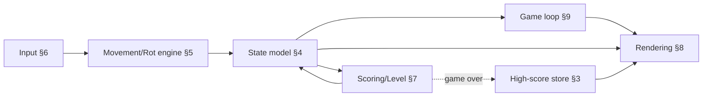

# Architecture: Falling Blocks

**Item**: `falling-blocks` · **App Target**: `marketplace-item` (app facet only)
**Inputs**: `spec.md` (source of truth), `mockup.html` (binding visual contract)

A single-player, keyboard-only, canvas-rendered falling-blocks (tetromino) game
delivered as **one self-contained `index.html`** — all HTML/CSS/JS inline, no
external libraries, CDNs, network calls, or image assets. Because the deliverable
is one file, the "architecture" below is the **internal module decomposition of
that file**, not BOS subsystems. There is no service/daemon facet and no BOS-source
change.

---

## 1. Classification

**`marketplace-item` — app facet only, single self-contained HTML file.**

Rationale (per `build-studio` → `references/target-marketplace-item.md`):
- Self-contained tool with its own lifecycle; the one persistence feature is a
  browser-local `localStorage` leaderboard. It needs no BOS internal APIs, no OS
  state, no daemon → the "app only, trivial — one static HTML file" shape,
  installed via `app_install({ name, html, icon })`.
- Not `builtin-app`: it touches no BOS subsystem and has no reason to be compiled
  into the browser; the built-in-vs-marketplace tie-breaker
  (`docs/dev/guides/apps.md` §1 — "self-contained tool with its own lifecycle →
  marketplace") settles it as marketplace.
- Not `bos-core`: zero `src/` involvement.

**No `services/` facet.** Nothing here runs continuously, needs a non-standard
protocol, or binds a port — so none of the service-reachability / headless-auth
concerns apply. App facet only.

**Agrees with `spec.md`** `App Target: marketplace-item`. No reconciliation needed.

---

## 2. Constitution check

| Principle | Status |
|---|---|
| I. Spec-Driven | ✅ This design derives from the ratified `spec.md`; `plan.md`/`tasks.md` follow. |
| II. Server Authority / SSR boundary | ✅ N/A — no server code, no secrets, no Node APIs. All state is client/browser-local. |
| III. Always Delegate; Claude Codes | ✅ Implementation is delegated to the Developer (`contentOnly:true`) → `app_install`; Build Studio never writes the file. |
| IV. Minimize Blast Radius | ✅ No BOS-source change; install lands on the `user-apps` `app-candidate` draft branch (previewable via Topbar "Promote app"/"Discard app"). |
| V. The VFS Is Not the Source | ✅ Item content lives in the `user-apps` GitFS repo, not BOS source. |
| VI. Specs & Docs Stay in Sync | ✅ Item ships its own `spec/`; no BOS `docs/` affected (it's a user item, not a BOS feature). |
| VII. Respect Boundaries | ✅ No `package.json`/lockfile/build-config edits; no new external dependency. |

No conflicts. The single new "dependency" is the browser platform itself (canvas,
DOM, `localStorage`) — see ADR-5.

---

## 3. Architecture

### Context
A user opens **Falling Blocks** from the desktop. It renders as a sandboxed
**iframe at `/apps/<id>`** (`docs/dev/apps/installed-apps.md` — a static app is
`app/index.html` served as-is; the serving route injects a `<base>` and BOS SDK,
but this app calls **no** BOS API, so it is effectively standalone). Inside the
iframe: a fixed 672px "window" with a title bar and three columns — left
(`Next` preview + `Controls` legend), center (10×20 `board` canvas + game-over
`overlay`), right (`Status` HUD + `High Scores`). The player uses the keyboard
exclusively.

### Container (BOS's actual ones, briefly)
- **The item's own git repo** — `data/user-apps/items/falling-blocks/` (user-apps
  GitFS). Content is `app/index.html` (+ install-written `app/app.json`).
- **The sandboxed iframe** at `/apps/falling-blocks/` — the only runtime container
  this item has. No worker thread, no Supervisor preview worktree, no Bastion
  surface, no own port.

### Component — internal decomposition of the single file
One `<!doctype html>` document with an inline `<style>` (theme + layout) and one
inline `<script>` organised into these labelled sections, which is also the unit
of test/review. DOM owns the panels (HUD, next-panel chrome, high-score lists,
overlay, controls legend); **canvas owns only the playfield and the next-preview**.

1. **Config & constants** — `COLS=10`, `ROWS=20`, `CELL=22` (→ board canvas
   220×440; next canvas 88×88); the 7 piece colours; the scoring table
   `{1:100, 2:300, 3:500, 4:800}`; `LINES_PER_LEVEL=10`; `HS_KEY` (localStorage
   key); `HS_MAX=10`.
2. **Tetromino shape table** — 7 shapes (I, O, T, S, Z, J, L), each with its
   per-rotation cell offsets and fixed colour (see §3.1).
3. **High-score store** — load/persist top-10 with in-memory fallback (ADR-3);
   `record(score) -> rankIndex|−1` (0-based rank of the recorded score within the
   top-10, or −1 if it didn't make the cut), `list() -> number[]` (descending,
   ≤10, `[]` when the store is empty). **Empty / first-run:** a fresh install or
   cleared storage gives `list() === []`; the first-ever `record(s)` is rank `0`
   (displayed rank 1) and earns the "New high score" badge (badge condition in
   ADR-3).
4. **Game state model** — one `state` object: `grid` (ROWS×COLS of `null`|
   colourKey), `active` `{shape, rot, x, y}`, `next` (shape key), `score`,
   `lines`, `level`, `phase` (`'playing'`|`'gameover'`), plus a derived
   `fallMs`. Functions: `reset()`, `spawn()`, `collides(shape,rot,x,y)`,
   `mergeActive()`, `clearFullRows() -> n`, `gameOver()`.
5. **Movement/rotation engine** — `move(dx)`, `rotate()`, `softDrop()`,
   `hardDrop()`, and the kick resolver (ADR-2). Each mutates `state.active` only
   when the target position passes `collides()` → clipping is structurally
   impossible (FR-008, SC-003).
6. **Input handling** — `keydown` handler + held-key tracking (DAS, ADR-4);
   maps ←/→/↑/↓/Space/Enter; `window.blur`/`visibilitychange` → pause (edge case
   "loses keyboard focus").
7. **Scoring & level** — `addLineScore(n)` (multi-line beats same-rows-solo,
   FR-010/SC-004), soft/hard-drop bonuses, `recomputeLevel()` =
   `floor(lines/10)+1` driving `fallMs` (FR-012/013, ADR-1 note on speed).
8. **Rendering** — `renderBoard()` (locked cells → faint grid → drop-ghost →
   active piece with glow), `renderNext()` (centre shape in 88×88), `renderHUD()`
   (DOM: score/lines/level), `renderHighScores()` (DOM lists — side `#hsSide` and
   overlay `#hsGo` — with `.top`/`.new` highlighting, **all keyed off the single
   `record()` rank** so the two lists stay in sync), `renderOverlay(show)`.
   **Empty state**: when `list()` is empty (fresh install / cleared storage), both
   surfaces render either an empty list or one muted "No scores yet" placeholder
   row — never a phantom entry, and **no** "★ New high score" badge. The `.new`
   highlight (and therefore the badge) exists only at the row whose value is the
   just-recorded score, which exists only after a qualifying `record()`.
9. **Game loop** — `requestAnimationFrame` with a fixed-timestep accumulator for
   gravity (ADR-1); render every frame, step gravity when the accumulator passes
   `fallMs`.



### 3.1 Tetromino representation
Each shape is `{ color, rotations: [ [ [r,c],…4 cells… ] ×4 ] }` where each
rotation is four `[row, col]` offsets inside a bounding box: **I** uses a 4×4
box, **O** a 2×2 box (rotation is a no-op — identical across all 4 states), the
rest use a 3×3 box. `collides()` tests every offset as `(active.x + c,
active.y + r)` against bounds and `grid`. Worked example (T, spawn = rot 0):
rot 0 `[[0,1],[1,0],[1,1],[1,2]]`; rot 1 `[[0,1],[1,1],[1,2],[2,1]]`; rot 2
`[[1,0],[1,1],[1,2],[2,1]]`; rot 3 `[[0,1],[1,0],[1,1],[2,1]]`. I: rot 0
`[[1,0],[1,1],[1,2],[1,3]]` … the other three rotations are the same row/col
band transposed. O: `[[0,0],[0,1],[1,0],[1,1]]` for all four. The implementer
generates the remaining rotations by 90°-rotating the offset set within the box;
only T is shown here as the reference. Colours are fixed and match the mockup:
I `#22d3ee`, O `#fde047`, T `#c084fc`, S `#4ade80`, Z `#f87171`, J `#60a5fa`,
L `#fb923c` (FR-002, SC-002 — all seven appear over a full session because the
spawner is a uniform random pick from the 7).

### 3.2 State machine

```mermaid
stateDiagram-v2
  [*] --> Playing: load (reset + spawn first piece)
  Playing --> Playing: move / rotate / soft / hard drop / line clear
  Playing --> GameOver: spawned active piece cannot be placed
  GameOver --> GameOver: (loop halted; overlay shown; score recorded)
  GameOver --> Playing: Enter → reset()
```



- **Playing**: gravity ticks via the loop; input active; HUD/next/high-scores
  live.
- **GameOver**: reached the instant `spawn()`'s piece collides at its start
  position (FR-015/016). The loop stops stepping gravity; `record(finalScore)`
  runs here (FR-021) and its return value drives the overlay. The overlay card is
  shown over the piled board with the final score, the **re-sorted top-10** (the
  just-recorded entry, if it made the cut, is `.new`-highlighted), and a pulsing
  "Enter Restart" prompt. The **"★ New high score" badge shows iff
  `record(finalScore)` returned a rank in `0..9`** (the score made the top-10
  cut) — precise, tie-deterministic condition in ADR-3. The first score into an
  empty list is rank `0`, so the **first-ever game over earns the badge**.
- **Reset** (from GameOver on Enter): clears grid, zero score/lines/level=1,
  re-randomises active + next, phase → Playing, overlay hidden (FR-017, SC-007).

---

## 4. Concrete file/module plan

At implement time (produced by the Developer, installed by `app_install`), the
item is exactly:

```
falling-blocks/
└── app/
    └── index.html      # THE deliverable — single self-contained file
    └── app.json        # name/icon, written by app_install (not hand-authored)
```

Nothing else. `index.html` internal layout (the §3 component map):

```
<!doctype html>
<html>
 <head>
   <meta …><title>Falling Blocks</title>
   <style>
     /* THEME  — tokens copied from mockup.html :root (dark palette, 7 piece
        colours, --mono/--sans)
        LAYOUT — 672px .window, title bar, 3-column .body (190px | auto | 190px),
                 .panel/.ph, .stat, .hs list, .ctrl/.key, .playfield-wrap,
                 .overlay/.go-card  (all per mockup, incl. glow/ghost/overlay
                 box-shadows and the pulse keyframe) */
   </style>
 </head>
 <body>
   <!-- DOM: stage → window → body → [col L: next canvas + controls legend],
        [col C: board canvas + overlay card], [col R: status HUD + high scores] -->
   <canvas id="board"></canvas>
   <canvas id="next"></canvas>
   <ul id="hsSide"></ul>
   <div id="overlay"> … #hsGo … </div>
   <script>
     /* §1 CONFIG & CONSTANTS
        §2 TETROMINO SHAPE TABLE
        §3 HIGH-SCORE STORE (localStorage + fallback)
        §4 GAME STATE MODEL (grid/spawn/collide/merge/clear)
        §5 MOVEMENT & ROTATION ENGINE (+ kick resolver)
        §6 INPUT HANDLING (+ DAS, focus pause)
        §7 SCORING & LEVEL
        §8 RENDERING (board/next/HUD/high-scores/overlay)
        §9 GAME LOOP (rAF fixed-timestep)
        §10 BOOTSTRAP (init canvas, load HS, reset, start loop) */
   </script>
 </body>
</html>
```

No `services/`, `config/`, `hooks/`, or plugin facets. No `src/`, no
`manifest.ts`, no `data/user-apps` hand-edits.

---

## 5. Integration points

This is a plain app — it integrates **only with the browser platform**, no BOS
APIs:

| Need | Mechanism | Note |
|---|---|---|
| Playfield + next preview | `<canvas>` 2D (`getContext('2d')`) | DPR-scaled like the mockup (`devicePixelRatio`) for crisp cells. |
| HUD, panels, lists, overlay, controls | DOM (`document.*`) | Rebuilt/updated from state; `toLocaleString()` for score. |
| High-score persistence | `window.localStorage` | Feature-detected + try/catch; in-memory fallback (ADR-3). |
| Controls | `window` `keydown`/`keyup` + `blur`/`visibilitychange` | `preventDefault` on handled keys to stop page scroll. |
| Timing / animation | `requestAnimationFrame` | Fixed-timestep gravity (ADR-1). |
| Serving | BOS static-app iframe at `/apps/falling-blocks/` (`src/app/apps/[...slug]/route.ts`) | Serves `app/index.html` as-is; app uses no injected BOS SDK. |

Because the app calls no same-origin BOS API, no `window.__bos` capability or
capability declaration is needed in `app.json`.

---

## 6. ADRs

### ADR-1 — Fixed 22px cell, fixed 672px window (not responsive)
- **Context**: The mockup is the binding contract and is authored at a fixed
  size: `COLS×CELL = 220`, `ROWS×CELL = 440`, `672px` window, `88px` next box.
  NFR-003 only requires legibility at the default layout without scrolling.
- **Options**: (a) fixed 22px cells / 672px window; (b) responsive scaling
  (rem/clamp + CSS transform or `ResizeObserver` re-fit).
- **Decision**: **(a) fixed.** Pixel-perfect to the mockup, and cell→px math is a
  constant (`x*CELL`). No resize handling, no blur from non-integer scaling.
- **Consequences**: On very small viewports the body already scrolls (mockup
  `overflow:auto`), which is acceptable and matches NFR-003's "default layout
  size" scope. Revisit only if a mobile target is ever added (out of scope, v1).

### ADR-2 — Ordered rotation-kick set (classic-style, not full SRS)
- **Context**: FR-005/FR-008/SC-003 require the piece to rotate 90° and *never*
  clip a wall or stack — "rejected **or** kicked to a valid position." Edge case:
  rotation blocked on all sides must leave the piece in its last valid
  orientation.
- **Options**: (a) **reject-only** — if the rotated footprint collides, don't
  rotate; (b) **ordered kick set** — try the rotation in place, then a small ordered set
  of nudges, take the first valid; (c) **full SRS** (Super Rotation System)
  per-transition kick tables + floor-kick rules.
- **Decision**: **(b) an ordered rotation-kick set.** Apply rotation; if it
  collides, try offsets in order `[ (0,0), (0,-1), (0,+1), (0,-2), (0,+2), (-1,0),
  (+1,0) ]` (row, col) and keep the first that passes `collides()`. The **same
  fixed ordered set is applied identically to every piece and every
  rotation→rotation transition** — this is *not* per-transition SRS. **O** is a
  no-op (never rotates). If none is valid, the rotation is rejected entirely (no
  clipping).
- **Consequences**: Resolves the classic "rotate against a wall/stack" cases the
  spec calls out, with predictable, minimal movement. Simpler and fully sufficient
  for this feature than full SRS (no spin-combo/floor-kick edge semantics the spec
  asks for); a reviewer wanting exact SRS parity would note it, but (c) buys no
  spec-visible behaviour at real cost. **T-spin and I-spin special-casing are
  intentionally OMITTED** — no spin detection, no spin-specific scoring bonus, no
  I-piece wall/floor-kick carve-outs. This keeps rotation classic NES-style
  (consistent with the spec's single/double/triple/quad line scoring, which
  defines no spin bonuses); the omission is a deliberate decision, not an
  accident, so a reviewer shouldn't flag the absence of T-spins as a gap.

### ADR-3 — High-score `localStorage` with in-memory fallback
- **Context**: FR-019/022, SC-009 — persist top-10 across reloads, but if
  `localStorage` is unavailable/disabled, run a session-only in-memory list and
  **never throw** (private browsing, quota, or sandboxed-iframe quirks).
- **Options**: (a) try/catch every access inline; (b) **capability probe once at
  boot** and route all read/write through a small store object that is
  back-store- or memory-backed.
- **Decision**: **(b).** At bootstrap, run a probe (`setItem`/`getItem`/`removeItem`
  round-trip in try/catch) to pick a backing: `window.localStorage` or a module
  `let` array. All §3 functions (`load`/`save`/`record`) call the backing via one
  pair of helpers, so a mid-session failure can't leak a throw into gameplay.
  `record(score)`: push, sort **descending with a stable order for equal scores**
  (insert-after-existing-equal — deterministic per the edge case), cap at 10,
  **return the 0-based rank of the recorded score if it made the top-10 cut, else
  −1**, persist. `list()` returns the descending array, or `[]` when the store is
  empty (fresh install / cleared storage).

  **"New high score" badge — precise condition.** The overlay's "★ New high
  score" badge is shown **iff `record(finalScore)` returned a rank in `0..9`**
  (the score made the top-10). Because the sort is stable insert-after-existing-
  equal, an equal score that **ties the cut line still makes it in** (it is placed
  after the existing equal and lands within the first 10), so the badge is
  **deterministic on ties** — the same score against the same list always agrees.
  This `record()` rank is the **single source of truth**: the overlay's `.new`
  highlight, the side-list's `.new`/`.top` styling, and the badge all key off the
  same result, so the side panel and the overlay stay in sync. **Empty / first-
  run:** with an empty list the first-ever `record(s)` is rank `0` (displayed rank
  1) and **earns the badge**; while the list is empty, neither surface shows a
  badge or a phantom entry (it renders an empty list or one muted "No scores yet"
  placeholder — see §3 Rendering and §3.2).
- **Consequences**: Persisted normally, degrades silently to session-only. Sorting
  is score-only (no names — FR-020).

### ADR-4 — Input: held-key DAS without clipping
- **Context**: Edge case "holding a movement key (auto-repeat) vs single press —
  movement must not clip through blocks." Native `keydown` auto-repeat fires many
  events/sec; naive per-event single-cell moves feel sluggish and are timing-
  dependent.
- **Options**: (a) rely purely on native `e.repeat`; (b) **DAS** — on first
  `keydown` move once, start a *delay-then-repeat* timer (e.g. 170ms delay,
  40ms repeat) driven off the same rAF loop; (c) velocity-based movement.
- **Decision**: **(b) DAS** tracked in the input section, stepped inside the rAF
  loop. Every movement action — initial, repeat, or a manual single press — goes
  through the same collision-checked `move(dx)`, so **no path can ever clip**
  (satisfies the edge case regardless of timing).
- **Consequences**: Responsive held-key movement, deterministic and frame-rate
  independent (tied to the same accumulator as gravity). (a) is simplest but
  less feel; (c) is overkill and re-introduces clipping risk.

### ADR-5 — Zero external dependencies; browser platform only
- **Context**: NFR-001 — single self-contained file, no libs/CDNs/network/images.
- **Options**: (a) plain canvas + DOM + `localStorage` (no deps); (b) pull in a
  small game lib (PixiJS, etc.).
- **Decision**: **(a).** The feature is trivially within the canvas 2D + DOM
  APIs; a lib would only add a network/CDN dependency NFR-001 forbids and no
  capability we lack.
- **Consequences**: ~zero bundle beyond the one HTML file; the only "dependency"
  is the browser itself. Rendering (block bevel/glow, ghost, grid, overlay blur)
  is hand-drawn with `createLinearGradient`/`shadowBlur`/`setLineDash` exactly as
  in the mockup's `drawBlock`/`drawGhost`/`rr` helpers.

### ADR-6 — requestAnimationFrame with a fixed-timestep accumulator for gravity
- **Context**: NFR-002/SC-005 — smooth ~60fps and a fall speed that is
  *measurably* level-driven and **independent of display refresh** (60/120/144Hz
  monitors must all fall the same wall-clock speed). A per-frame "drop one cell"
  would fall 2× faster on a 120Hz display.
- **Options**: (a) `setInterval` per level; (b) per-frame step; (c) **rAF +
  accumulator** (fixed timestep).
- **Decision**: **(c).** Each frame: `acc += (now - last)`; `while (acc >=
  fallMs) { gravityStep(); acc -= fallMs; }`; render unconditionally. `fallMs` is
  recomputed on level change.
- **Consequences**: Gravity is wall-clock-deterministic at any refresh rate;
  render stays at display rate (smooth). `fallMs = max(80, 800 - (level-1)*60)`
  is the chosen curve (level 1 = 800ms, −60ms/level, floor 80ms at level 13) — a
  concrete, testable ramp (SC-005) that's trivial to tune. **Level is unbounded
  (FR-013), but `fallMs` is clamped by the `max(80, …)` floor — every level ≥ 13
  holds the 80ms floor**, so speed saturates and never drops below 80ms. DAS
  (ADR-4) shares the same `now` clock so input and gravity never drift apart.

---

## 7. Risks / open questions

- **Sandboxed-iframe `localStorage` origin**: in an opaque-origin iframe,
  `localStorage` *may* be unavailable depending on BOS's sandbox attrs — this is
  exactly what ADR-3's fallback absorbs, so behaviour is correct either way.
  *Verification at implement*: confirm the top-10 persists across a reload in the
  installed app; if the iframe is opaque-origin, the in-memory fallback is the
  expected, non-buggy outcome (SC-009 still holds; SC-008 requires persistence
  which depends on same-origin — flag to Build Studio if the installed app turns
  out opaque-origin and persistence is deemed required).
- **Focus loss semantics**: spec edge case allows "pause *or* at minimum not
  register stray keys." This design **pauses** (stops gravity + ignores keys) on
  `blur`/`visibilitychange` and resumes on refocus — the friendlier reading.
  Not a decision that needs sign-off, but call it out so `tasks` encode "pause."
- **Spawn position**: pieces spawn near the top, centred (I at col 3 in a 4-wide
  box, others at col 3 in a 3-wide box) with `rot=0`; a spawn that immediately
  collides triggers GameOver (FR-015). Matches the mockup's "top blocked"
  game-over board.
- **Scoring nuance**: soft/hard-drop points are awarded *per row actually
  dropped* (the delta of the move), not per keypress — so holding Down and a hard
  drop each count their real row travel (FR-010). Confirm `tasks` phrase it that
  way to avoid the "per-press" misread.
- No genuinely ambiguous items requiring a human decision beyond the
  opaque-origin persistence note above.

---

## 8. UI mockup reference

`mockup.html` (sibling of this file) is the **binding visual contract**. Its
screens/states map to components as follows:

| Mockup element | Maps to | Section |
|---|---|---|
| `:root` palette + 7 `--p*` colours | theme tokens + `COLORS` table | §1, §2 |
| `.window` (672px), title bar, 3-col `.body` | static DOM layout | §4 |
| `canvas#board` (220×440, 22px cells) + faint grid + bevelled blocks + active-piece **glow** | `renderBoard()` locked cells | §3.8 |
| `drawGhost` dashed outline (active piece at rest position) | `renderBoard()` drop-ghost, recomputed each frame | §3.8 |
| `canvas#next` (88×88, piece centred) | `renderNext()` | §3.8 |
| Status panel: Score (hero) / Lines / Level | `renderHUD()` (DOM, `toLocaleString`) | §3.8 |
| High Scores panel (`#hsSide`), `.top` + `.new` styling | `renderHighScores()` | §3.8, §3.3 |
| Controls legend (←/→/↑/↓/Space/Enter) | static DOM (documents the input map) | §6 |
| `.overlay` + `.go-card` ("Game Over", final score, "★ New high score" badge, Top 10, pulsing "Enter Restart") | `renderOverlay(show)` + `record()` badge logic | §3.2, §3.8, §3.3 |
| Mockup "Playing / Game Over" state switcher | **not part of the app** — a mockup affordance; the real app transitions state via the §3.2 state machine | §3.2 |

The mockup's `drawBlock`/`drawGhost`/`rr`/`rgba`/`setupCanvas` helpers are a
ready reference for §3.8's canvas code (DPR scaling, rounded-rect bevel with
top-light/bottom-dark gradient, ghost at 10% fill + 55% dashed stroke, glow via
`shadowBlur`).
