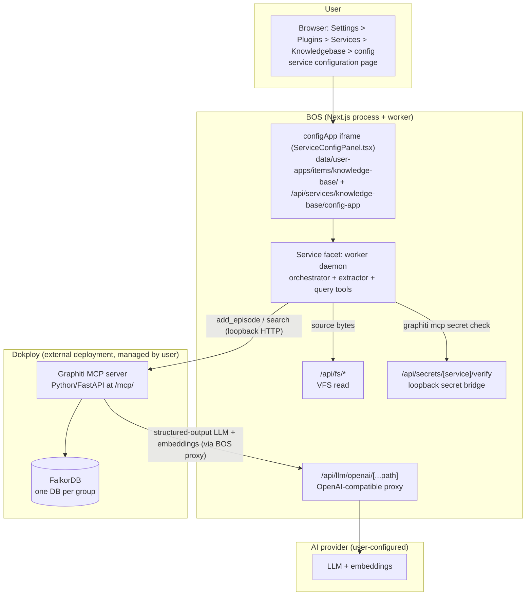

# Knowledge Base — Architecture Design (Revision 3)

**Feature branch**: `bos/038-knowledge-base`
**Spec**: `/Specs/user-specs/038-knowledge-base/spec.md`
**Status**: Revision 3.1 — Graphiti engine, service-config delivery (no per-agent access assignment)
**Date**: 2026-08-06

This is a **design artifact** (what should exist), not an implementation. It supersedes Revision 2 of this document.

**What changed in Revision 3** (per user decision 2026-08-06):
1. **No per-agent access assignment.** The Settings → Agents → [agent] → Knowledge bases surface is removed from scope. There is no per-KB, per-agent query-grant mechanism. The `kb-settings.html` mockup is deferred/archived.
2. **The KB management UI is delivered via the service configuration mechanism**, not a standalone window app. The UI is the service's `configApp` (self-contained HTML served at `/api/services/<id>/config-app`), rendered in **Settings → Plugins → Services → Knowledgebase → config**. The `038-knowledge-base.html` mockup is the UI contract for that config page.
3. **Full functional scope retained**: create/manage/delete KBs, upload / Google Drive / website sources, ingestion, query tools.

The retrieval engine remains **Graphiti** (getzep/graphiti, a temporal knowledge graph) per the locked decisions in the Revision-2 rework brief; the storage and ingestion architecture are unchanged from Revision 2 except for the removal of the per-KB assignment layer and the app facet.

---

## 1. Classification

**App Target: `marketplace-item`** — now **service facet only** (no app facet). This agrees with `spec.md`'s revised `App Target` field.

This item carries a **single facet**:

- **Service facet** (`services/`): a worker-thread service daemon (per the Service Daemons model, `/Specs/user-specs/002-service-daemons/spec.md`) that is the **orchestrator + extractor** for ingestion, the **owner of the configuration UI**, and the **host of the agent query tools**.
- **Configuration UI**: the service declares `settingsRegistration.configApp` pointing at a self-contained HTML file (the `038-knowledge-base.html` mockup, implemented properly). `ServiceConfigPanel.tsx` renders it in an `<iframe` via `/api/services/<id>/config-app`, so the KB management surface appears at **Settings → Plugins → Services → Knowledgebase → config**.

There is **no app facet** — the management UI is the config page, not a window. The item does **not** ship the Graphiti engine itself — Graphiti (Python), FalkorDB (its graph DB), and the Graphiti MCP server are **external services deployed and managed by the user in Dokploy**, separate from BOS. The BOS item is the controller/frontend; the worker daemon talks to the Graphiti MCP server over loopback HTTP.

Rationale for `marketplace-item` (unchanged): every deliverable is self-contained under `data/user-apps/items/knowledge-base/` — the config UI, the service worker, the parsers, the tool wiring. **There is NO BOS core source change: the Graphiti stack is deployed externally by the user in Dokploy, so neither `docker-compose.yml` nor any other BOS source is modified.** The item's code (service facet + config UI) needs no `src/` change.

---

## 2. Constitution Check

Relevant principles and compliance:

- **II. Server Authority & SSR Boundary** — COMPLIANT. Secrets (Drive OAuth tokens, Graphiti MCP auth, model keys) stay in server code behind `src/app/api/**/route.ts`; the worker daemon never sees client secrets in plaintext. The Graphiti MCP server's own auth secret is provisioned by the worker via the loopback verify bridge (`src/app/api/secrets/[service]/verify/route.ts`) — the worker cannot import `src/lib/secrets/service-secrets.ts` directly (see §7).
- **II — Reasoning/thinking models use Chat Completions** — COMPLIANT. Graphiti's structured-output LLM calls go through BOS's `/api/llm/openai/[...path]` proxy (the user's configured OpenAI-compatible provider), not a separate model host.
- **IV. Minimize Blast Radius** — COMPLIANT. All feature code lives in the marketplace item (its own repo under the content store); no `src/` edits, no shared-state mutation. Runtime index/state persists under `data/`, not in `src/`.
- **V. VFS Is Not the Source** — COMPLIANT. The worker reads source bytes via BOS VFS APIs (`/api/fs/*`); it does not write BOS source. Its own journal/state files live under the item's `data/`.
- **VI. Specs & Docs Stay in Sync** — COMPLIANT by process: this design references the spec and docs; the plan/implement must keep `docs/usage` in sync.
- **Telemetry / local-first privacy** — COMPLIANT ONLY IF Graphiti telemetry is disabled. Graphiti phones home to PostHog by default (`capture_event('graphiti_initialized', ...)` on init). The Dokploy deployment **must** set `GRAPHITI_TELEMETRY_ENABLED=false` for local-first/privacy. This is a hard requirement, flagged in risks (§9) and the deployment ADR (§8).
- **No new dependency without alternatives** — COMPLIANT: Graphiti adoption is justified against alternatives in ADR-1/2 below; every new dependency (FalkorDB, parsers) is checked against existing BOS mechanisms first.

---

## 3. Architecture

### 3.1 Context

The user opens **Settings → Plugins → Services → Knowledgebase → config** (the service's configuration page), creates KBs, adds sources (uploads / Google Drive folder / website URL). Agents in BOS (built-in assistant + marketplace agents) query KBs through **agent query tools** (`kbs_tool_search`, `kbs_tool_retrieve`). The actual retrieval engine is **Graphiti**, deployed externally by the user in Dokploy; BOS never embeds it.

### 3.2 Containers

BOS's real containers involved:

1. **Next.js app process** (`src/`) — hosts `/api/fs/*`, `/api/llm/openai/[...path]`, `/api/secrets/[service]/verify`, Drive invoke routes, the services config route, and the generic Settings → Plugins → Services panel that manages installed items. `ServiceConfigPanel.tsx` renders the service's `configApp` in an iframe.
2. **The worker-thread service daemon** for this item (`data/user-apps/items/knowledge-base/services/`) — runs outside the Next.js request pipeline (per Service Daemons model). Owns: the configuration UI host, ingestion orchestration, per-format text extraction, content-hash de-dup, the ingestion state journal, and the **agent query tools**.
3. **The item's own git repo / content store** — hosts the service facet + config UI.
4. **Graphiti MCP server** (Dokploy, **external**) — Python FastAPI/uvicorn; exposes the Graphiti SDK over MCP with HTTP transport at `/mcp/`. Receives `add_episode` / `search` / etc. calls.
5. **FalkorDB** (Dokploy, **external**) — Graphiti's graph DB backend. Each Graphiti **group = a separate FalkorDB database** (hard partition).
6. **BOS's AI provider** — Graphiti's LLM (structured-output entity/edge extraction) and embeddings go through BOS's `/api/llm/openai/[...path]` proxy to the user's configured OpenAI-compatible provider.
7. **Supervisor + preview worktrees** — only relevant if the item's source is promoted; not a runtime container for this feature.

### 3.3 Component diagram (Context)



### 3.4 Components (the item's real files)

Detailed in §4. At a high level, the worker (`services/`) owns ingestion orchestration + extraction + query tools; the Graphiti MCP server owns graph write + retrieval; the config page (service's `configApp`) owns UI.

---

## 4. Concrete File / Module Plan

All paths are under the marketplace-item root `data/user-apps/items/knowledge-base/`. Per the target reference, only the applicable facet paths are listed; no `src/` paths (those belong to `builtin-app` designs and are omitted here, not marked N/A).

### 4.1 Item root

| Path | Purpose |
|---|---|
| `manifest.ts` (or `manifest.json`) | Item manifest per marketplace-item anatomy: id, name, version, facets (service only), supported source types, permissions. |
| `README.md` | Item documentation. |

### 4.2 Configuration UI (the service's `configApp`)

The management UI is a self-contained HTML file declared via `manifest.settingsRegistration.configApp`, served at `/api/services/knowledge-base/config-app` and rendered by `ServiceConfigPanel.tsx` in an iframe. Screens map directly to the `038-knowledge-base.html` mockup.

| Path | Purpose | Mockup mapping |
|---|---|---|
| `config/config.html` (the `configApp`) | The service's configuration page — KB management UI (single self-contained HTML, or built to a single bundle). Includes a **Graphiti MCP endpoint setting** (FR-014) so the user can point the worker at their Dokploy-deployed MCP server. | Whole mockup: empty/populated KB list, KB detail, dialogs. |
| `config/` (supporting assets) | JS/CSS/images referenced by the config page. | — |

### 4.3 Service facet (`services/`)

The worker daemon. Per Service Daemons model: worker thread, no direct function exports (IPC only), own configurable port, `bound` message publishing. The worker owns the query tools (no app facet; tools live here).

| Path | Purpose |
|---|---|
| `services/entry.ts` | Worker thread entry: starts orchestrator, publishes `bound` with the item's local port + `httpPath`, registers IPC handlers. |
| `services/service.json` | Service config: `configSchema`, `httpPath`, `settingsRegistration.configApp` (path to `config/config.html`), secrets it needs (Graphiti MCP secret, Drive OAuth). **Any configurable port defaults to `0`** (per services.md §3 "Choosing a port" — never a fixed number; see ADR-6). |
| `services/orchestrator.ts` | Ingestion pipeline controller: owns the queue, state journal, retry policy, content-hash de-dup, source refresh scheduling. |
| `services/journal.ts` | Persisted ingestion state journal (per-source status: Pending → Indexing → Indexed / error; last-synced; retry count). Written under the item's `data/`. |
| `services/sources/` | Per-source acquisition + refresh. |
| `services/sources/upload.ts` | Upload source: read bytes via `/api/fs/raw` or `/api/fs/download`. |
| `services/sources/gdrive.ts` | Google Drive source: invoke route for Drive access (OAuth token via invoke route + folder listing), incremental refresh. |
| `services/sources/website.ts` | Website source: crawler (same-domain subtree, depth/limit cap), incremental re-crawl. |
| `services/extract/` | Per-format text extraction (pure-JS parsers — see §5). |
| `services/extract/pdf.ts` | PDF → text via `pdfjs-dist` (or `pdf-parse`). |
| `services/extract/docx.ts` | DOCX → text via `mammoth`. |
| `services/extract/pptx.ts` | PPTX → text via `pptxjs`-style parser (or `mammoth`-equivalent). |
| `services/extract/xlsx.ts` | XLSX → text via `xlsx` (SheetJS). |
| `services/extract/txt.ts` | TXT → text (utf-8 decode). |
| `services/extract/md.ts` | MD → text (strip markup to plain text). |
| `services/extract/html.ts` | HTML → text via `cheerio` (or `node-html-parser`). Used for website source pages. |
| `services/chunker.ts` | Chunking decisions (§5.3). |
| `services/graphiti/client.ts` | Loopback HTTP client for the Graphiti MCP server (`/mcp/`): `add_episode`, `search_nodes`, `search_memory_facts`, `get_episodes`, `delete_episode`, `clear_graph`, `summarize_saga`, `build_communities`, `get_status`. **The endpoint is read from config — user-set in the config UI (FR-014).** |
| `services/graphiti/schema.ts` | MCP tool request/response types. |
| `services/tools.ts` | Agent query tool implementations (`kbs_tool_search`, `kbs_tool_retrieve`) — wired as BOS agent tools (see §6). |
| `services/provenance.ts` | Maps Graphiti `NodeResult`/`EdgeResult` → agent-facing passages with source provenance (via `get_episodes`). |

### 4.4 Data / runtime state

| Path | Purpose |
|---|---|
| `data/kbs.json` | KB metadata: id, name, description, created/updated. |
| `data/sources.json` | Source metadata per KB. |
| `data/journal.json` | Ingestion journal (see `services/journal.ts`). |
| `data/hashes.db` | Content-hash registry for FR-008 de-dup. |

> The Graphiti index itself (graph + embeddings + FalkorDB DBs) is **not** in the item's `data/` — it lives in the user's Dokploy-deployed FalkorDB volume.

---

## 5. Ingestion Pipeline — In Detail

This is the core of the feature. Each stage names **where it lives** (worker vs Graphiti).

### 5.1 Pipeline overview

```
Source (upload / gdrive / website)
   │  worker: acquire bytes (§5.2)
   ▼
Extract text per format (§5.4)   ─── worker, pure-JS parsers
   ▼
Chunk (§5.3)                     ─── worker
   ▼
Content-hash de-dup (§5.5)       ─── worker (FR-008)
   ▼
add_episode(group_id=KB)         ─── worker → Graphiti MCP (/mcp/)
   ▼
Graphiti: LLM entity/edge extraction (structured-output) ─── Graphiti → BOS /api/llm proxy
   ▼
Graph write (episodes → graph)   ─── Graphiti → FalkorDB (per-group DB)
   ▼
Indexed                        ─── journal marks "Indexed"
```

### 5.2 Source acquisition (worker)

- **Upload**: app uploads via `/api/fs/upload`; the worker reads bytes via `/api/fs/raw` or `/api/fs/download`. Source reference = VFS path.
- **Google Drive**: worker calls BOS's Drive **invoke route** (OAuth token never leaves server code; Constitution II). Lists files in the selected folder; for each text-extractable file, fetches bytes via the invoke route.
- **Website**: worker's crawler fetches pages under the same-domain subtree, depth/limit-capped (configurable). Robots-disallowed / unreachable pages skipped with a crawl note (FR-011 edge case).

### 5.3 Chunking decisions (worker)

Graphiti's native unit of input is the **episode** (`add_episode(name, episode_body, ...)`), not a chunk. The worker decides how documents map to episodes:

- **Default**: one document = one episode (`episode_body` = full extracted text). This is simplest and lets Graphiti's own temporal/entity model do the heavy lifting.
- **Large documents**: split into multiple episodes (e.g. by heading/section boundaries or a soft token cap) so each episode stays within the structured-output LLM context and preserves provenance granularity. Episodes for the same document share `name` prefix + `source_description`.
- **Per-page for websites**: each crawled page = one episode.
- `reference_time` = document last-modified (or crawl time) so Graphiti's temporal graph ordering is meaningful.
- `source_description` = the source identity (upload path / Drive file id / page URL) — this is what provenance uses later.
- `source` is **not** the BOS source type (`upload`/`website`/`drive`) — it is Graphiti's own content-format enum for `add_memory`, which its live `inputSchema` restricts to `'text'` (default) / `'json'` / `'message'`. Since the worker always calls `add_memory` with already-extracted plain text (§5.4), `source` is always `'text'`, regardless of the original file format or BOS source type. Passing the BOS source type here (e.g. `'upload'`) made the live server warn `Unknown source type 'upload', using 'text' as default` and then fail the episode with `node ... not found` — the malformed argument corrupted the server's episode processing even though it superficially fell back to a valid default (bugfix round, 038-knowledge-base).

The **chunk count** the UI shows ("214 chunks") is reinterpreted as episode count (see §5.7).

### 5.4 Per-format extraction (worker, pure-JS)

| Format | Parser | Notes |
|---|---|---|
| PDF | `pdfjs-dist` | Text layer extraction; fallback `pdf-parse`. |
| DOCX | `mammoth` | Word → text/html → plain text. |
| PPTX | `mammoth`-equivalent / `pptx` parser | Slide text extraction. |
| XLSX | `xlsx` (SheetJS) | Cell text extraction. |
| TXT | built-in | UTF-8 decode. |
| MD | built-in / `marked` | Strip markup to plain text. |
| HTML | `cheerio` | For website pages: extract readable text (strip nav/scripts). |

Extraction failure → journal marks source `Failed` with actionable message; KB stays queryable (FR-011; mockup `tab-health` error card with Retry / Replace / Remove).

### 5.5 Content-hash de-dup (worker, FR-008)

The worker computes a content hash of the extracted text (SHA-256). If a hash is already indexed for that KB, re-adding is **idempotent** — skip `add_episode`, no duplicate graph nodes. Hash registry in `data/hashes.db`. Re-ingesting changed content (new hash) re-runs the pipeline.

### 5.6 add_episode → Graphiti → graph write

The worker sends `add_episode` to the Graphiti MCP server over **loopback HTTP** (`/mcp/`), with `group_id = <KB id>`. Graphiti then:
1. Calls the structured-output LLM (via BOS `/api/llm/openai/[...path]` proxy) to extract entities + edges.
2. Embeds the episode content (embeddings via the same proxy).
3. Writes episodes → graph → FalkorDB (per-group DB).

The worker does **not** do the LLM extraction or the graph write itself — that lives in Graphiti (Python side). The worker only pushes text episodes and reads back results.

### 5.7 Retrieval-unit reinterpretation (Q=A decision)

The spec resolved **Q = A** ("search + retrieve passages"). Graphiti's native retrieval returns **entities** (`search_nodes` → `NodeResult`: uuid, name, labels, summary, attributes, group_id) and **facts** (`search_memory_facts` → `EdgeResult`: source → fact → target), **not raw passage chunks**. **Explicit design decision:**

> **The agent query tools return Graphiti entities + facts, with provenance reconstructed to source passages via `get_episodes`.** A `search_nodes` hit maps back to the episode(s) it was extracted from; `get_episodes(reference_time, ..., group_id)` returns the raw episode text, which we surface as the "relevant passage." Facts are surfaced as the relationship triple (source → fact → target) plus the supporting episode text.

So the mockup's "214 chunks" is shown as episodes indexed; the agent-facing result is an entity/fact with a **passage citation**. This satisfies Q=A (the agent gets passages) while honoring Graphiti's native retrieval model. The `search_nodes`/`search_memory_facts` + provenance mapping lives in `services/provenance.ts`. See ADR-5.

### 5.8 Future: multimodal images

v1 targets text-extractable formats only (spec Non-Goals). Future extension: `services/extract/image.ts` sends image bytes to the provider's vision model via the `/api/llm` proxy and ingests the resulting caption/description as episode text. Noted, not built.

### 5.9 Queue / state journal / retry

- **Queue** (`services/orchestrator.ts`): a bounded queue of `IngestionJob`s (per source). Incremental/chunked — large Drive folders / websites never block the app (FR-011 edge case).
- **Journal** (`services/journal.ts`): persisted per-source status (`Pending` → `Indexing` → `Indexed` / error), last-synced, retry count. The config page reads this via IPC for the Sources/Health views.
- **Retry**: provider rate-limit/unavailable (FR-011 edge case) → job backlogs, status "Pending/Retrying", exponential backoff; queryable content remains available.
- **Deletion wins**: deleting a source/document while indexing cancels/ignores the in-flight job (spec edge case).

---

## 6. Agent Query Tools

| Tool | Graphiti mapping | Notes |
|---|---|---|
| `kbs_tool_search` | `search_nodes(group_ids=[...])` | Returns entities (`NodeResult`). Provenance added via `get_episodes`. |
| `kbs_tool_retrieve` | `search_memory_facts(group_ids=[...])` | Returns facts (`EdgeResult` source→fact→target). Provenance added. |

Both tools accept a target KB id and query that KB's Graphiti group. Results are entities/facts with **passage citations** reconstructed from `get_episodes` (per the Q=A decision in §5.7).

> **Removed in Revision 3**: the per-agent access-assignment layer (the old §6 access control, `services/access.ts`, `assignedAgentIds`, availability injection) is **gone**. There is no per-agent query grant. The query tools query any KB the requesting agent addresses. There is no identity-forwarding dependency, no `filterAllowed`/`buildSkillsIndexBlock` mirror, and no per-request grant check.

---

## 7. Integration Points

Existing BOS mechanisms this design **calls into but does not create or modify**:

| Mechanism | Real route/file | Used for |
|---|---|---|
| Graphiti MCP HTTP endpoint | External service at `/mcp/` (streamable HTTP transport) | Worker loopback calls: `add_episode`, `search_nodes`, `search_memory_facts`, `get_episodes`, `delete_episode`, `clear_graph`, `summarize_saga`, `build_communities`, `get_status`. |
| OpenAI-compatible proxy | `src/app/api/llm/openai/[...path]/route.ts` | Graphiti's structured-output LLM + embeddings (user's configured provider). |
| VFS upload/raw/download | `src/app/api/fs/upload`, `src/app/api/fs/raw`, `src/app/api/fs/download` | Upload source bytes. |
| Drive invoke route | `src/app/api/integrations/.../invoke/route.ts` (Drive integration) | Google Drive OAuth + folder listing + file bytes. |
| Loopback secret verify | `src/app/api/secrets/[service]/verify/route.ts` | Worker verifies/provisions the Graphiti MCP secret without importing `src/lib/secrets/service-secrets.ts` (worker can't import `src/lib/...` — note below). |
| Service config / reachability | `src/app/api/services/[id]/config/route.ts` (returns `httpPath`) | Exposes the worker service to the config UI / clients. |
| **Config page host** | `src/app/api/services/[id]/config-app/route.ts` + `src/components/apps/settings/ServiceConfigPanel.tsx` | Serves the item's `settingsRegistration.configApp` and renders it in Settings → Plugins → Services → Knowledgebase. **This is the delivery mechanism for the KB management UI.** |
| Settings → Plugins → Services panel | generic BOS UI surface | User manages the installed item (start/stop/configure). |
| Supervisor proxy (§9) | `docs/dev/apps/services.md` §11 | Reachability of the worker service behind a reverse proxy (see ADR-6). |

> **Worker cannot import `src/lib/...` modules.** The worker-thread entry runs unbundled, outside the `@/` module graph. It reaches BOS resources **only** via loopback HTTP to real API routes — the same pattern as VFS access. Secrets → `/api/secrets/[service]/verify`; config → services config route; never a TypeScript import of `service-secrets.ts`.

---

## 8. ADRs

### ADR-1: Graphiti adoption replaces a pure-JS store

- **Context**: An earlier draft proposed embedding chunks into a pure-JS store (`flexsearch` + `sqlite-vector`). That store is moot — Graphiti provides temporal graph retrieval (entities + facts) with a first-class group model.
- **Decision**: Adopt Graphiti (Apache 2.0) as the retrieval engine. Graphiti requires a graph DB (FalkorDB) + embeddings; the user accepted this.
- **Consequences**: (+) temporal graph, entity/fact retrieval, group-based KB isolation (hard FalkorDB partition per group). (−) Python sidecar + graph DB deployment weight. Graphiti is not embeddable in Node → worker reaches it over loopback HTTP.

### ADR-2: Ingestion pipeline lives in the worker

- **Context**: Extraction + orchestration could live in the Graphiti Python side, but the worker already owns source access (VFS/Drive/crawler) and the item's state.
- **Decision**: The worker does source acquisition + per-format extraction + chunking + de-dup + queue/journal; Graphiti does LLM extraction + graph write. The worker pushes text episodes via MCP.
- **Consequences**: Keeps heavy orchestration in the item's Node side; Graphiti stays a thin retrieval/extraction service. Clear stage ownership (§5).

### ADR-3 (updated): Delivery via service configuration page

- **Context**: Revision 2 proposed a separate window app (app facet) for the KB management UI. Per the user decision, the management UI should instead be delivered through the service's configuration mechanism — the service declares `settingsRegistration.configApp`, which `ServiceConfigPanel.tsx` renders as the service's config page at Settings → Plugins → Services → Knowledgebase → config.
- **Decision**: The KB management UI is the service's `configApp` (self-contained HTML served via `/api/services/<id>/config-app`). There is **no app facet**. The `038-knowledge-base.html` mockup is the UI contract (FR-013).
- **Consequences**: (+) no separate window/app-facet packaging; the UI is reachable where the service is configured; single install surface. (−) the UI is not a dock/window app — it lives in Settings, which is the intended trade-off per the user's direction.

### ADR-4: Graphiti stack deployed externally by the user (Dokploy)

- **Context**: Graphiti (Python), FalkorDB, and the Graphiti MCP server must run alongside BOS but separate from it. The user deploys and manages this stack themselves in **Dokploy** (a separate deployment platform), so BOS does not ship or orchestrate it.
- **Decision**: The Graphiti/FalkorDB/MCP stack is **deployed by the user in Dokploy, external to BOS**. There is **no BOS `docker-compose.yml` change** (no BOS core source modification) and the marketplace item ships **no docker-compose file**. The worker daemon reaches the user's Dokploy-deployed Graphiti MCP endpoint over loopback HTTP.
- **Consequences**: (+) no BOS core source change at all; BOS stays thin; the user controls the Graphiti stack lifecycle/upgrades in Dokploy. (−) the user must deploy + keep the Graphiti stack running in Dokploy; Graphiti telemetry **must** be disabled (`GRAPHITI_TELEMETRY_ENABLED=false`) for local-first/privacy (flagged in §2/§9). **The Graphiti MCP endpoint is user-configurable in the service's configuration page (FR-014)** — the user sets it to their Dokploy-deployed MCP URL; a default (`http://127.0.0.1:8020/mcp/`) is provided but editable in the config UI.

### ADR-5: Retrieval unit = entities/facts + provenance

- **Context**: Q=A (return passages), but Graphiti's native retrieval is entities/facts.
- **Decision**: Tools return entities/facts with passages reconstructed via `get_episodes`. See §5.7.
- **Consequences**: Agent gets passages (spec-compliant) on top of Graphiti's native model. Cost: provenance mapping layer (`services/provenance.ts`).

### ADR-6: Service port defaults to 0 + reachability

- **Context**: The worker service binds its own port; behind a reverse proxy (Bastion/Dokploy/Traefik) that port is not directly exposed.
- **Decision**: Any configurable port in `services/service.json` **defaults to `0`** (services.md §3 "Choosing a port" — the Terminal incident precedent). Reachability uses `httpPath` from `GET /api/services/<id>/config`, proxied through the Supervisor (`docs/dev/apps/services.md` §11). The design does **not** invent a public URL for the service; it cites the Supervisor proxy mechanism.
- **Consequences**: The worker's `httpPath` is the only externally-reachable URL; all three deployment scenarios (Bastion / Supervisor-only / standalone) follow services.md §11's table.

---

## 9. Risks / Open Questions

1. **Python sidecar + graph DB weight (HIGH)**: Graphiti + FalkorDB + MCP server add real deployment weight (Dokploy services, memory). Mitigated: they're external services, not embedded; the user accepted graph DB + embeddings. Telemetry must be disabled.
2. **Structured-output / embeddings route confirmation (MEDIUM)**: Graphiti needs structured-output LLM (2 model calls per episode) + embeddings via BOS `/api/llm/openai/[...path]`. This depends on the user's provider supporting JSON-mode/structured output and an embeddings endpoint on the same base URL. Verified the proxy is a generic OpenAI-compatible passthrough; per-provider behavior needs confirmation at implement.
3. **Config-page ↔ worker bridge (MEDIUM)**: the config page (an iframe served at `/api/services/<id>/config-app`) must reach the worker's state (KB list, source status) and issue commands (create/delete KB, add source). The exact IPC/bridge between the iframe and the worker service needs confirmation at implement — likely the worker's `httpPath` (proxied through the Supervisor) or a BOS API route.
4. **MCP auto-registration (MEDIUM)**: Whether BOS auto-registers the Graphiti MCP server as an MCP server for agents needs confirmation at implement — but agent query tools are wired as custom tools through the worker, not through generic MCP auto-registration, so this is lower-risk.
5. **FalkorDB per-group DBs (LOW-MEDIUM)**: each KB = a separate FalkorDB database. Many KBs = many DBs. Acceptable for a single-user personal OS; monitor DB count at scale.
6. **Graphiti telemetry (must-fix)**: PostHog phone-home disabled via `GRAPHITI_TELEMETRY_ENABLED=false`; verify in compose config.
7. **Graph DB dependency / Kuzu deprecated**: Graphiti's hard graph-DB dependency is FalkorDB; Kuzu (used in some examples) is deprecated — deployment pins FalkorDB.

---

## 10. UI Mockup Reference

- **Path**: `/Specs/user-specs/038-knowledge-base/038-knowledge-base.html` (inside the spec directory).
- **Role**: UI contract for the service's configuration page (FR-013). The delivered `configApp` MUST conform to this mockup.
- **Mapping**: detailed in §4.2. Key screens/states: empty KB list, populated master-detail list, KB detail (Sources / Health tabs — the Access tab was removed per Revision 3), and modals (New KB, Add Source, Upload, Drive connect, Website).
- **Deferred**: `/Specs/user-specs/038-knowledge-base/kb-settings.html` — the per-agent access-assignment page. **Archived / not implemented** (per-agent access removed in Revision 3).

---

## Self-consistency check (third failure mode)

Re-reading this draft for any claim that a **service facet imports a `src/lib/...` module directly**: none exists. §7 explicitly states the worker reaches BOS resources only via loopback HTTP (`/api/secrets/[service]/verify`, services config route) — never a TypeScript import of `service-secrets.ts` or any `src/lib/...` module. The worker is self-contained on the Node side; Graphiti (Python) is reached over HTTP. There is no per-agent access-control layer (removed in Revision 3), so no `filterAllowed`/`buildSkillsIndexBlock` mirror exists anywhere.

---

*Design artifact. Plan (`plan.md`) and tasks (`tasks.md`) are written by Build Studio referencing this document.*
