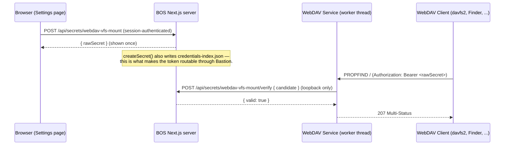

# Architecture Design: WebDAV VFS Mount

## Classification

**App Target**: `marketplace-item` — service facet only.

**Rationale**: The spec describes a background WebDAV daemon that binds its own HTTP port and is reached through the Supervisor's existing service-reachability mechanism (`docs/dev/apps/services.md` §11). No companion UI is required — the generic Settings → Plugins → Services panel with its built-in Config/Logs actions is sufficient.

**Note on spec alignment**: The spec's `App Target: marketplace-item` is correct and matches the `target-marketplace-item.md` classification for a background daemon that needs to handle raw HTTP/WebDAV protocols — exactly the kind of thing the service facet exists for.

**Correction to a prior revision of this document**: an earlier version of ADR-4 chose to hand-roll a self-contained token generation/hashing/storage scheme entirely inside the worker thread, because `src/lib/secrets/service-secrets.ts` isn't importable from an unbundled worker. That reasoning about imports was correct, but the conclusion was wrong: a token minted and verified this way is never registered in `credentials-index.json`, so Bastion's headless Basic-auth routing rejects every request at the front door before it ever reaches the service's own check — this happened for real, in production, and is why AUTH-002 exists in the spec now. The correct answer (ADR-4, below) is the same loopback-bridge pattern already used for VFS access, applied to secrets instead of reinventing token storage.

---

## Constitution Check

- **Spec-Driven**: Follows the spec-kit pipeline; the spec is the source of truth.
- **Server Authority**: The daemon is server-side only — no SSR boundary issues.
- **Minimize Blast Radius**: Lives in `data/user-apps/items/<id>/` — no BOS source changes for the item itself. (The loopback secrets bridge it depends on — `/api/secrets/[service]` and `/api/secrets/[service]/verify` — is real BOS source, added once, reusable by every future service; see Integration points.)
- **VFS is not the source**: The service calls `/api/fs` and `/api/fs/raw` via plain loopback HTTP — the same pattern every other BOS service uses for VFS access, and now also for secrets (see ADR-4).

---

## Architecture

### Context

A user (or agent) installs the WebDAV VFS Mount item, which registers a background WebDAV daemon. The service maps standard WebDAV methods (PROPFIND, GET, PUT, DELETE, MKCOL, HEAD) to VFS HTTP API calls. Any WebDAV-compatible client can connect to the service and interact with the VFS as a remote file server.

**Critical architectural point**: The service binds its own real HTTP port (default `0` — OS-assigned) using plain Node `http.createServer()`, exactly like the Terminal service does with its WebSocket server. It is reached from outside the container via the Supervisor's existing service-proxy mechanism (`docs/dev/apps/services.md` §11) when one is present, or directly by `host:port` when it isn't (plain `npm run dev`). There is no portless routing anywhere in this design.

**Second critical point (auth)**: The service holds no token material of its own, ever. Minting/listing/revoking a token is a browser-initiated action against `/api/secrets/webdav-vfs-mount` (session-authenticated); verifying a presented token is a loopback call the worker makes to `/api/secrets/webdav-vfs-mount/verify`. Both are BOS's own Generic Secrets mechanism (`service-secrets.ts`), not anything this item implements itself.



### Container

**Worker-thread process**: The service runs as a `worker_threads` worker, entirely outside Next.js's request pipeline. It loads completely outside the Next.js/webpack bundle — a plain Node script, not a Next.js route or middleware.

**Service manifest**: `services/service.json` declares the service's identity, entry point, config schema, and settings registration. The `entry` field points to the worker script (`services/index.js`).

**Config**: The service reads config from `dataDir()/config/<id>/<name>.json` (user-editable) — `port` (default `0`) and `host` (default `127.0.0.1`) only. No token/hash material lives here at all (see ADR-4) — that's the whole point of the loopback bridge.

**Lifecycle**: The service is auto-started on install (eager startup). The service manager handles startup sequencing and crash recovery (exponential backoff, default 5 restarts) and topological dependency resolution (none for this service). On start, `ServiceManager.ts` pre-checks a fixed, non-zero configured port against BOS's own reserved ports before ever spawning the worker (refusing to start with a visible error in Settings if it collides) — another reason the config default MUST be `0`, which skips that check entirely by always being safe.

### Component

The implementation follows the `target-marketplace-item.md` conventions:

```
webdav-vfs-mount/
├── services/
│   ├── service.json      # { id, name, version, entry, configSchema, settingsRegistration }
│   └── index.js          # The actual daemon — binds its own http.Server, verifies via loopback
├── config/
│   └── webdav-vfs-mount.json  # port (default 0), host — no token/hash material
└── templates/
    └── config.html        # Self-contained config UI — mint/list/revoke via /api/secrets
```

**`services/service.json`**:
```json
{
  "id": "webdav-vfs-mount",
  "name": "WebDAV VFS Mount",
  "version": "1.0.0",
  "description": "Expose VFS over WebDAV for native mount support",
  "entry": "index.js",
  "configSchema": {
    "type": "object",
    "properties": {
      "port": { "type": "number", "default": 0, "description": "HTTP port — 0 lets the OS assign one automatically (recommended; see docs/dev/apps/services.md §3)" },
      "host": { "type": "string", "default": "127.0.0.1", "description": "Interface to bind" }
    }
  },
  "settingsRegistration": {
    "label": "WebDAV Service",
    "icon": "server",
    "configApp": "templates/config.html"
  }
}
```

**`config/webdav-vfs-mount.json`**:
```json
{
  "port": 0,
  "host": "127.0.0.1"
}
```

### Auth flow (loopback verify — the corrected ADR-4)

The worker thread never generates, hashes, or stores a token:

1. `extractBearerToken(req)` pulls the presented candidate from `Authorization: Bearer <token>`.
2. `verifyCandidate(serviceId, candidate)` POSTs `{ candidate }` to `/api/secrets/webdav-vfs-mount/verify` over the same loopback base URL already used for `/api/fs` (`process.env.PORT`).
3. The route (`src/app/api/secrets/[service]/verify/route.ts`) calls `verifySecret("webdav-vfs-mount", candidate)` and returns `{ valid: boolean }` — never throws for a mismatch.
4. The auth gate runs before anything else, for every method including `OPTIONS`, on every request — no token minted yet means every request 401s (NET-003/US3).

### Config UI

The config UI is rendered as a self-contained HTML template (no React, no JS framework), registered via `settingsRegistration.configApp` in `service.json`. It pulls live data from `GET /api/services/webdav-vfs-mount/config` (connection info) and `GET /api/secrets/webdav-vfs-mount` (whether a token currently exists).

**What the Config UI Shows**:
1. **Server Connection** section with the port field (default 0, min 0, max 65535) and the address field
2. **Connection Instructions** for Windows, macOS, and Linux
3. **Access Token** section with generate/show/copy/regenerate
4. **Security Note** about the token

**Data Flow**:
- The port field reflects the actual configured port (from config) and allows the user to change it (`PATCH /api/services/webdav-vfs-mount/config`).
- The address is pulled live from `GET /api/services/webdav-vfs-mount/config`'s `httpPath` (proxied deployments) or `runtime.port` (standalone).
- **Generate**: `POST /api/secrets/webdav-vfs-mount` (mints server-side via `createSecret()`, also registers with Bastion's routing) — returns `rawSecret`, shown once.
- **Regenerate**: `GET /api/secrets/webdav-vfs-mount` to list existing secrets, `DELETE` each one, then `POST` to mint a new one — so the old token stops working immediately (AUTH-004), with nothing to invalidate on the worker's side since it never cached anything.
- The service itself is never involved in any of this — it only ever calls the `verify` endpoint, per-request.

**How the Config UI is Loaded**:
- When the user clicks "Config" on the WebDAV Service in Settings → Plugins → Services, the Settings panel loads the HTML template at `templates/config.html`.
- The template is a plain HTML file with inline CSS/JS (no external dependencies, no client-side crypto — an earlier revision hand-rolled a pure-JS SHA-256 implementation for client-side hashing; that's gone entirely now, since hashing happens server-side inside `createSecret()`).

---

## Concrete File/Module Plan

| File | Purpose |
|---|---|
| `data/user-apps/items/webdav-vfs-mount/services/service.json` | Service manifest (id, entry, configSchema — `port`/`host` only, settingsRegistration with `configApp`) |
| `data/user-apps/items/webdav-vfs-mount/services/index.js` | The actual daemon — binds its own HTTP port, handles WebDAV requests, verifies auth via loopback |
| `data/user-apps/items/webdav-vfs-mount/config/webdav-vfs-mount.json` | User-editable config: `port` (default 0), `host` — no token/hash material |
| `data/user-apps/items/webdav-vfs-mount/templates/config.html` | Self-contained HTML template for the config UI — mint/list/revoke via `/api/secrets/webdav-vfs-mount` |

Note: The service itself (`index.js`) is self-contained and uses only Node.js built-ins (`http`, `path`, `fs`) — no `@/` imports or framework dependencies, and (since the auth rewrite) no `crypto` either, since it no longer hashes anything itself. `runtime.json` is NOT part of this file plan — it's written by `ServiceManager.ts` after the service's first `bound` message, exactly like every other service (see `docs/dev/apps/services.md` §6).

---

## Integration points

| Mechanism | Cited to |
|---|---|
| Worker-thread service lifecycle, port binding, `runtime.json`, crash recovery | `src/core/service/ServiceManager.ts`, `docs/dev/apps/services.md` §6 |
| Reserved-port collision check on a fixed, non-zero configured port | `src/core/service/PortChecker.ts`'s `checkPortReservedByBos()`, `docs/dev/apps/services.md` §3 |
| Client-facing reachability (`wsPath`/`httpPath`, Supervisor proxy) | `src/app/api/services/[id]/config/route.ts`, `tools/supervisor/supervisor.mjs`, `docs/dev/apps/services.md` §11 |
| VFS file operations | `/api/fs`, `/api/fs/raw` |
| Secret mint/list/revoke (browser, session-gated) | `src/app/api/secrets/[service]/route.ts`, `src/lib/secrets/auth-scope.ts`'s `hasSessionScope()`, `docs/dev/features/headless-client-auth.md` |
| Secret verify (worker, loopback-only) | `src/app/api/secrets/[service]/verify/route.ts`, `src/lib/secrets/auth-scope.ts`'s `isLoopbackOnly()` |
| Bastion headless routing (why a mint-side secret works through Bastion at all) | `bastion/src/proxy.ts`, `bastion/src/credential-routing.ts`, `src/lib/secrets/credentials-index.ts` |
| Settings UI | Generic Settings → Plugins → Services panel (`ServiceCard.tsx`, `ServiceConfigPanel.tsx`) |

---

## ADRs

### ADR-1: Service Facet Only (No Companion UI)

**Context**: The spec requires a background WebDAV daemon. Auth is handled entirely through BOS's Generic Secrets loopback bridge (see ADR-4) — no dependency on a companion app beyond the plain HTML config template.

**Options**:
1. **Service facet only**: The service runs in the background; user manages it via Settings → Plugins → Services and a config template.
2. **App + Service facets**: Bundle a React app that provides a richer UI for managing the service.

**Decision**: Option 1 — service facet only. The spec does not require a companion app. The generic Settings → Plugins → Services UI plus a self-contained `templates/config.html` is sufficient.

**Consequences**:
- **Pros**: Simpler implementation, no React dependencies, faster iteration.
- **Cons**: The user cannot manage the service from within BOS beyond the standard Start/Stop/Restart/Config/Logs actions. If the spec later requires richer management, this needs to be extended.

### ADR-2: Each User Gets Their Own Service Instance

**Context**: Each user has their own VFS root in BOS. The service MUST expose the VFS directory tree exactly as it appears in Files, with all subdirectories and files mirrored.

**Options**:
1. **Each user gets their own service instance** (different process, each with their own VFS root and its own bound port).
2. **Single system-wide service** that routes by user context — but this requires the service to know each user's VFS root, which is not available to a shared process.

**Decision**: Option 1 — each user's BOS runs its own service instance. Each user's `data/user-apps/` is separate, and each user's BOS starts and binds its own instance of the service.

**Consequences**:
- **Pros**: Simple — each instance is independent; no routing complexity; each user's VFS is isolated by default.
- **Cons**: No cross-user sharing. But this matches BOS's per-user isolation model.

### ADR-3: Reachability via the Supervisor's Existing Service Proxy

**Context**: The service needs to be reachable from a real client in every BOS deployment mode — a multi-user Bastion deployment, a Supervisor-only deployment (no Bastion), and plain standalone `npm run dev`. It's tempting to invent a bespoke routing scheme for this, but BOS already has one, used by every other service with its own port (precedent: Terminal).

**Options**:
1. **Use the existing Supervisor service-proxy mechanism** (`docs/dev/apps/services.md` §11): the service binds a real port; `GET /api/services/<id>/config` returns `wsPath`/`httpPath` (proxied through the Supervisor) whenever one fronts BOS, or `null` under plain `npm run dev`, in which case the client falls back to a direct `host:port` connection using the OS-assigned `runtime.port`.
2. **Invent a new "path-proxy" mechanism that forwards raw requests into a portless worker.** Rejected — this does not exist anywhere in BOS's source; a design that assumed it fabricated the concept from scratch, and it was never actually verified against `docs/dev/apps/services.md` before being written down.

**Decision**: Option 1 — the existing Supervisor service-proxy mechanism, exactly as Terminal already uses it. The service's own config default port is `0` so it never collides with BOS's own reserved ports (Supervisor public port, base+preview-pool range — see `docs/dev/apps/services.md` §3).

**Consequences**:
- **Pros**: Works in all three deployment modes without hardcoding a URL anywhere; reuses a mechanism that's already implemented, tested, and used in production by Terminal — nothing new to build.
- **Cons**: The config UI must actually call `GET /api/services/webdav-vfs-mount/config` and branch on `wsPath`/`httpPath` vs. direct `host:port` rather than showing one static address — slightly more UI logic than a single hardcoded string, but this is the same logic Terminal's own bundled `app/index.html` already implements (see `docs/dev/apps/services.md` §12 for the worked example).

### ADR-4: Auth via a Loopback Bridge to BOS's Generic Secrets Mechanism

**Context**: The service needs to authenticate requests using a Bearer token, and that token needs to work through a multi-user Bastion deployment, not just in isolation.

**Options**:
1. **Custom token hash in config**: Generate/hash/store a token entirely inside the worker thread's own config file, verified with `crypto.timingSafeEqual`. **This was the original decision and it shipped a real production bug**: such a token is never registered in `credentials-index.json` (only `createSecret()` writes that), so Bastion's headless Basic-auth routing rejects every request at the front door before it ever reaches the service's own check — no matter how correct that check is.
2. **Loopback bridge to `service-secrets.ts`**: Mint/list/revoke via `POST`/`GET`/`DELETE /api/secrets/webdav-vfs-mount` (browser-initiated, session-gated — `hasSessionScope()`); verify via a loopback `POST /api/secrets/webdav-vfs-mount/verify` (worker-initiated, loopback-only — `isLoopbackOnly()`). The worker thread still never imports `service-secrets.ts` directly (impossible either way — no `@/` imports from a worker thread), but it also never reimplements what that module already does.
3. **Plain token in config**: Store the raw token in config — simple but insecure, and still wouldn't solve the Bastion-routing problem.

**Decision**: Option 2 — the loopback bridge, the same shape as the existing VFS bridge (`/api/fs`), applied to secrets. `createSecret()` writes both the authoritative encrypted record AND the `credentials-index.json` routing entry in one step, so a token minted this way works through Bastion automatically — no separate registration step, no drift between two authentication mechanisms.

**Consequences**:
- **Pros**: The service never generates, hashes, or stores a single byte of token material — "the consuming service doesn't have to think about propagating tokens anywhere" (the design goal of BOS's Generic Secrets mechanism) is now literally true, not just true for `@/`-graph code. Regeneration/revocation work correctly through Bastion by construction, since there's only one place a token is ever registered.
- **Cons**: Every auth check now costs one loopback HTTP round-trip instead of an in-memory comparison — negligible in practice (same cost as the VFS calls this service already makes per request), but worth noting as a design tradeoff, not a free lunch.

---

## Risks / Open Questions

1. **VFS root resolution**: The design assumes the VFS root can be resolved at startup or lazily on first request. The exact mechanism (env variable, config, or API call) needs clarification from whoever builds the VFS API.
2. **Large directory listings**: The service returns all entries at once, with no pagination. This is a known limitation for large directories.
3. **WebDAV protocol compliance**: Optional features like ETag, Last-Modified, and locking are not implemented — only the required methods (PROPFIND, GET, PUT, DELETE, MKCOL, HEAD).
4. **Security**: No rate limiting or connection throttling — relies on the reverse proxy's TLS and network-layer protections where one is present.
5. **Config UI must actually branch on deployment** (ADR-3) — verify this manually in at least one Supervisor-fronted test deployment, not just `npm run dev`, since that's the one case where `wsPath`/`httpPath` are non-null and the branch actually exercises the proxied path.
6. **Auth must be re-verified end-to-end through an actual Bastion deployment** (ADR-4, SC-005) — a unit test against the real `/api/secrets/webdav-vfs-mount/verify` route in isolation is necessary but not sufficient; the thing that broke before was specifically the Bastion-routing half, which only a real multi-user deployment test exercises.
