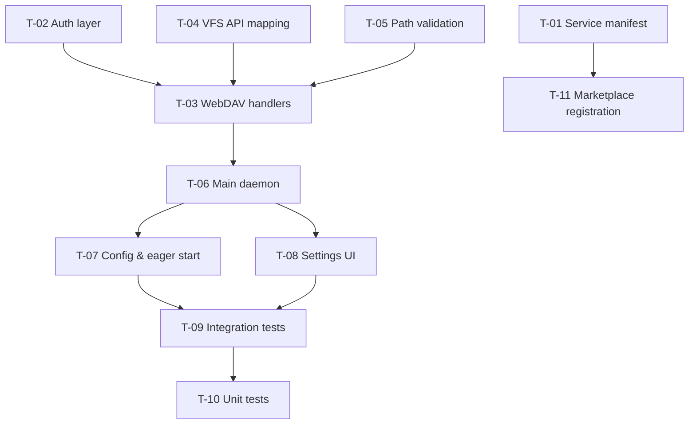

# Implementation Plan: WebDAV VFS Mount

## Overview

The WebDAV VFS Mount is a `marketplace-item` service facet — a background WebDAV daemon that binds its own HTTP port (defaulting to `0`, OS-assigned) and is reached through BOS's existing service-reachability mechanism (`docs/dev/apps/services.md` §11 — the same one Terminal already uses), not any bespoke routing. Each user gets their own service instance. Auth is via BOS's Generic Secrets mechanism (`createSecret`/`verifySecret`, `src/lib/secrets/service-secrets.ts`), reached over a loopback bridge (`/api/secrets/webdav-vfs-mount`, `/api/secrets/webdav-vfs-mount/verify`) — the service itself never generates, hashes, or stores a token.

**Spec**: `spec.md`
**Design**: `design.md`
**UI**: `templates/config.html`
**Tasks**: `tasks.md`

## Phases

### Phase 1: Scaffolding

Set up the marketplace-item directory and write `service.json` — the bare minimum that registers the service in BOS.

**Task**: T-01 — Project scaffolding & service manifest

### Phase 2: Core modules

Build the internal modules the daemon needs: auth (now a loopback bridge, not local crypto), VFS mapping, and path validation. Each is independently testable.

- **T-02** Auth layer (loopback verify via `/api/secrets/webdav-vfs-mount/verify`)
- **T-04** VFS API mapping layer (list/read/write/delete/mkdir → HTTP)
- **T-05** Path validation & directory traversal prevention

### Phase 3: WebDAV protocol

Implement the HTTP method handlers that translate incoming WebDAV requests into VFS operations.

- **T-03** WebDAV protocol handlers (PROPFIND, GET, PUT, DELETE, MKCOL, HEAD)

### Phase 4: Wire it all together

Connect the modules into the main daemon entry point, bind the HTTP port, and ensure eager startup.

- **T-06** Main daemon entry point (binds `http.createServer()` to `config.port`/`config.host`, reports `bound` via IPC, gates every request on the loopback auth check)
- **T-07** Config file & eager start behavior

### Phase 5: Configuration UI

Wire the service into the generic Settings → Plugins → Services panel, and show the actual reachable connection URL for the current deployment.

- **T-08** Settings UI integration (discovers the real connection URL via `GET /api/services/webdav-vfs-mount/config`; mints/lists/revokes tokens via `/api/secrets/webdav-vfs-mount`, never generates one client-side)

### Phase 6: Validation & Publishing

Verify the complete service end-to-end, then publish the item.

- **T-09** Integration testing
- **T-10** Unit tests
- **T-11** Marketplace registration

## Dependency graph

## Risk mitigation

| Risk | Mitigation |
|---|---|
| WebDAV XML responses are complex | Test with a real client (e.g., `curl -X PROPFIND`) |
| Path traversal attacks | Strict path sanitization + VFS root check |
| The service can't import `@/` modules | Self-contained Node script with only built-in modules; auth reached via loopback HTTP, not a direct import (see T-02) |
| VFS API changes | The VFS layer is isolated — only `vfsList`/`vfsRead`/etc. need updating |
| A fixed configured port collides with BOS's own reserved ports | `port` config defaults to `0` (OS-assigned); `ServiceManager.ts` refuses to start and surfaces a clear error if a non-zero port is ever explicitly set to a colliding value (see `docs/dev/apps/services.md` §3) |
| Config UI hardcodes a connection URL that only works in the one deployment mode it was tested in | Discover the real URL live via `GET /api/services/webdav-vfs-mount/config` (`wsPath`/`httpPath`/`runtime.port`) — verify manually in a Supervisor-fronted deployment, not just `npm run dev` |
| A token minted by hand-rolled worker-thread crypto never gets registered with Bastion's routing, so headless Basic auth is rejected at the front door regardless of how correct the service's own check is | This happened for real once (fixed in this revision) — auth MUST go through BOS's Generic Secrets loopback bridge (`/api/secrets/webdav-vfs-mount`, `createSecret()`/`verifySecret()`), never a self-contained hash-in-config scheme; verify end-to-end through an actual Bastion deployment (SC-005), not just the service's own check in isolation |

## Success criteria

1. All WebDAV methods (PROPFIND, GET, PUT, DELETE, MKCOL, HEAD) work against the VFS
2. Auth allows/denies correctly via bearer token, verified against BOS's own Generic Secrets mechanism over a loopback call — not a locally-stored hash
3. Path traversal is blocked
4. The service starts eagerly, returning 401 when no token has been minted yet
5. The VFS directory tree is mirrored exactly
6. The service binds its own port (default `0`, OS-assigned) and is reachable via BOS's existing Supervisor-proxy mechanism in every deployment mode — Bastion, Supervisor-only, and standalone
7. TLS is handled by the reverse proxy in front of BOS where one is present
8. The user can generate, view, and regenerate an access token from Settings — minted server-side via `/api/secrets/webdav-vfs-mount`, never generated client-side or by the worker thread
9. The service registers in the Settings → Plugins → Services panel
10. The item can be installed and used end-to-end, with the config page showing a connection URL that is actually correct for the deployment it's running under, AND a token minted from that page actually authenticating through a real multi-user Bastion deployment (SC-005) — not just against the service's own check in isolation
